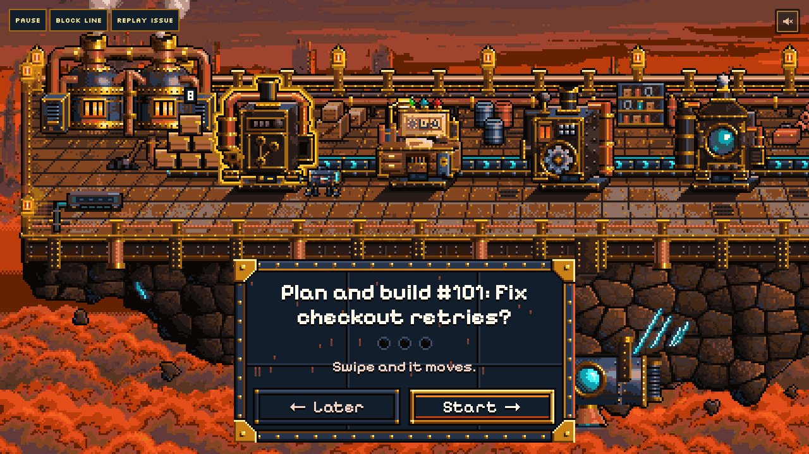

# Shiptorio

A game over your GitHub repo where what you decide really ships. Issues move through a pixel factory;
you approve the work and hold **Ship it** to merge a real pull request.

Shippy, your robot guide, is **powered by Meta Muse Spark**. It plans, picks what needs your attention and
reviews the result. Your own **Codex or Muse Code subscription** writes the code through a local runner on
your computer. Muse Spark is the brain, never the coder.



## How it works

1. Pick a GitHub issue. Shippy plans the change.
2. You approve the plan and the files it can change.
3. Your Codex or Muse Code builds it locally and opens a pull request.
4. Checks run CI and proof checks; Shippy reviews the result.
5. You hold **Ship it** at the Gate. The real PR merges, and a rocket launches.

The line: **Repo → Planner → Builder → Checks → Review → Gate → Launch**.

## Try it

Open [shiptorio.dev](https://shiptorio.dev) for the scripted preview. Creating your own factory currently
requires the preview password, GitHub sign-in and a [local runner](docs/site/runner.md).
The preview does not change a real repo.

To run the deck locally, install [Bun](https://bun.sh) and Node.js 22 or later:

```sh
git clone https://github.com/r3dbars/shiptorio.git
cd shiptorio
bun install
bun run dev:web
```

Open [localhost:5173/deck.html](http://localhost:5173/deck.html) for the scripted story.
Add `?source=sim` for a simulated factory. For the local Worker and database, run `bun run dev`
and open [localhost:8787](http://localhost:8787). Run `bun run check` before sending a change.

[Self-host on Cloudflare](docs/site/self-host.md) with your own GitHub App and Meta API key.
[Read the docs](docs/site/index.md), [runner setup](runner/README.md), or [contributor guidance](AGENTS.md).

## Event provenance

Built for the Meta AI Developer Hackathon. Building opened Oct 26, 2026 at 11:24 AM CT.
The initial README (9:33 AM), scaffold (`e2472b7`, 11:14 AM, about 4,500 lines) and wiring
(`31d4bb3`, 11:18 AM) preceded that opening. Work from `c7257d2` (11:27 AM) onward was built
during the event. Nothing was carried over from an earlier project.

The [review evaluation](docs/EVAL.md) records its small sample and limits; it is not a benchmark.

## License

[MIT](LICENSE). All game art is original. Fonts are SIL OFL 1.1; original synthesized music is
[CC0](web/public/music/LICENSES.md). Shiptorio is not affiliated with Wube Software or Factorio.
For security reports, see [SECURITY.md](SECURITY.md).
