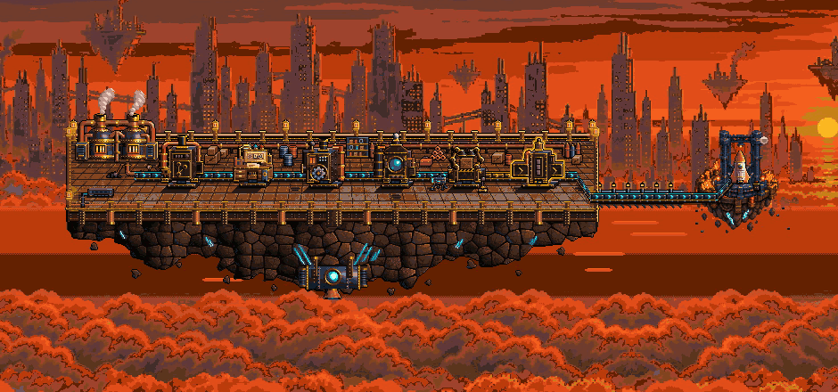
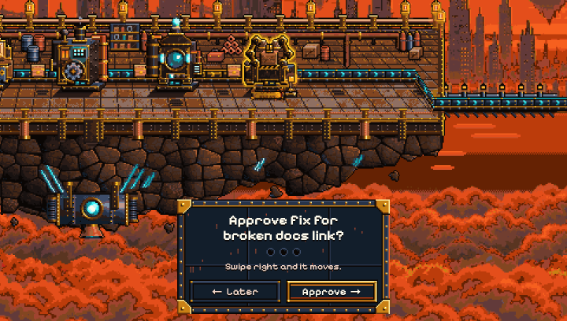
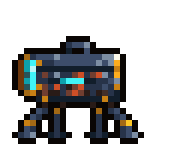
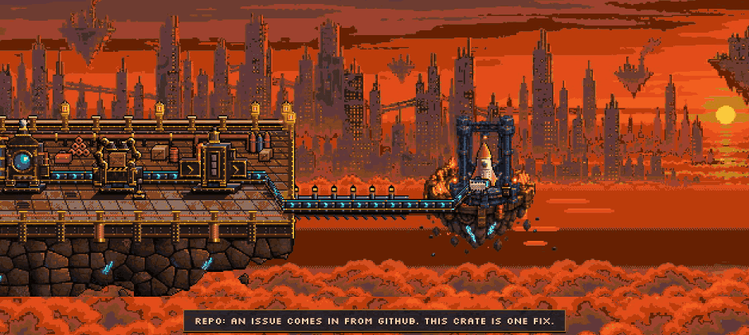
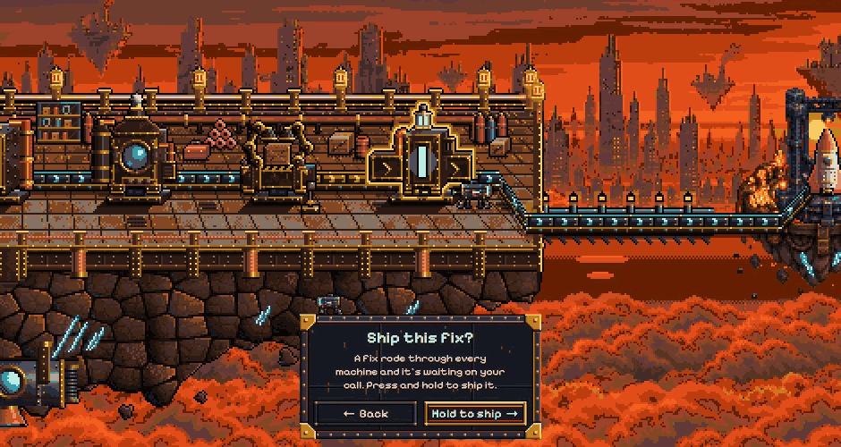
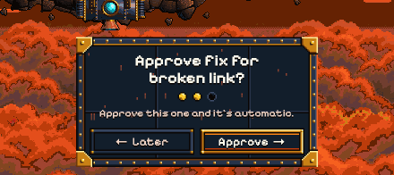
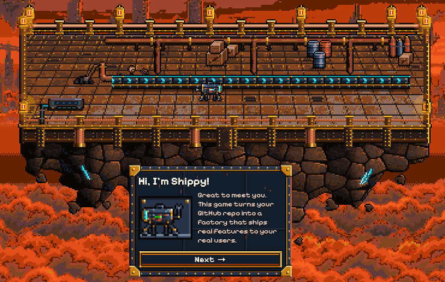
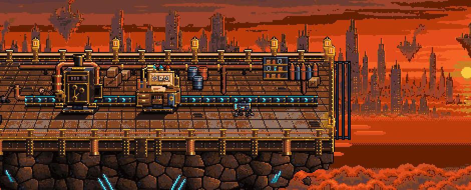
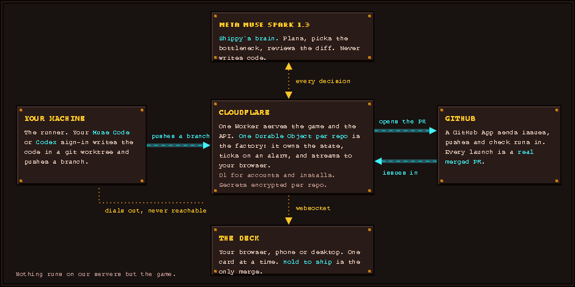
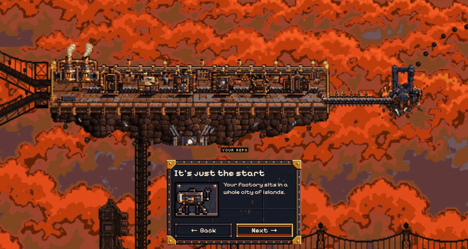

<p align="center">
  
</p>

<p align="center"><strong>A game you play on top of your GitHub repo. Every move ships something real.</strong></p>

<p align="center">
  
</p>

Your issues are the raw material. Each one rides a pixel conveyor through the Planner, the Builder, Checks
and Review, and stops at the Gate. You hold **Ship it**. A real pull request merges, and a rocket goes up.

## Why

AI writes the code now. The slow part is the person: deciding what gets built, what gets checked, and
what's safe to merge. Shiptorio puts those decisions in front of you one card at a time, makes every yes safe
with checks you can see, and rewards you for adding more checks. The more you verify, the more the factory
runs on its own.

<p align="center">
  
</p>

## Meet Shippy



Shippy is the robot who runs your line. **Meta Muse Spark 1.3 is Shippy's brain.** It reads your issues, plans the
change, spots the bottleneck, reviews the result and tells you what to do next. It never writes code.

The code is written by your own **Meta Muse Code subscription**, through a small runner on your machine. In the
game, your sign-in is the power plant: more power, bigger factory.
Nothing runs on our servers but the game.

<br clear="left">

## How a fix ships

1. **Repo.** An issue arrives on the line.
2. **Planner.** Shippy proposes a plan and the files it may touch. You approve or send it back.
3. **Builder.** Your Meta Muse Code writes the change on your machine and opens a pull request.
4. **Checks.** CI, lint and tests run on the PR. A failed check sends it back to the Planner, with a scar so you can see it was caught.
5. **Review.** Shippy reads the diff and gives a verdict.
6. **Gate.** You hold **Ship it**. The PR merges for real.
7. **Launch.** Rocket.

<p align="center">
  
</p>
<p align="center">
  
</p>

The first few times, you approve everything. Approve the same kind of change a few times and the factory
starts doing that step without asking. Ship it always waits for a human.

<p align="center">
  
</p>

## Play

- **Try it:** [shiptorio.dev](https://shiptorio.dev). Shippy walks you through a scripted factory in about two
  minutes. Nothing in the walkthrough touches a real repo.
- **Build your own:** sign in with GitHub, pick a repo, install the runner with one line, and your first issue
  becomes your first real launch. Runner setup: [docs/site/runner.md](docs/site/runner.md).

<p align="center">
  
</p>

Your factory starts as a bare platform. Each station is built as Shippy introduces it.

<p align="center">
  
</p>

## Run it yourself

Needs [Bun](https://bun.sh) and Node 22+.

```sh
git clone https://github.com/r3dbars/shiptorio.git
cd shiptorio
bun install
bun run dev:web
```

Open [localhost:5173/deck.html](http://localhost:5173/deck.html). Add `?source=sim` for a simulated factory.
`bun run dev` starts the full Worker with a local database on [localhost:8787](http://localhost:8787).
Every setting is listed, empty, in [`.env.example`](.env.example). Server values go in `server/.dev.vars`, which
`bun run dev` creates for you: `META_API_KEY` turns on Muse Spark, the GitHub App keys turn on real repos.
None of them are needed for the simulated factory.

### For judges: watch Muse Spark think, locally

The brain lab is a local page that sends real calls to Meta Muse Spark 1.3 (and Muse Wonder 1.0, side by side)
with your own Meta API key. It needs nothing else: no GitHub App, no Cloudflare, no real repo.

```sh
git clone https://github.com/r3dbars/shiptorio.git
cd shiptorio
bun install
cp server/.dev.vars.example server/.dev.vars   # then set META_API_KEY= in server/.dev.vars
bun run brain:lab
```

Open [localhost:5199](http://localhost:5199). Pick a scenario, edit its signals, and ask the model which
bottleneck to fix; **Run the eval** grades every case. `META_API_KEY=... bun run brain:lab` works too. Calls are
billed to your key.

**The live site is a private preview during judging.** GitHub sign-in on [shiptorio.dev](https://shiptorio.dev)
is limited to an allow list (`ALLOWED_LOGINS`), so you can't load your own repo there. Use the repo instead: the
brain lab above, the simulated factory (`bun run dev:web`, then
[localhost:5173/deck.html?source=sim](http://localhost:5173/deck.html?source=sim)), or the full local Worker.

To host it: [self-host on Cloudflare](docs/site/self-host.md) with your own GitHub App and Meta API key.
Everything else is in the [docs](docs/site/index.md). Contributing: [AGENTS.md](AGENTS.md).

## Under the hood

One Cloudflare Worker serves the game and the API. Each repo gets its own Durable Object that owns the
factory state, ticks on an alarm and streams to the browser over a websocket. GitHub events arrive through a
GitHub App. The runner dials out from your machine, works in a git worktree, and pushes a branch; the server
opens the PR. Secrets are encrypted per repo and never reach the browser or the logs.

Every decision Shippy makes is a call to the Meta Model API that has to answer in a fixed JSON shape: triage,
the plan, the bottleneck pick and the review all come back the same way, so each one is checked and logged.
The planner and reviewer work in a small tool loop that can read the issue, the code and the CI result, but
never write anything.

<p align="center">
  
</p>

## Coming soon: the rest of the city

Your software factory is the first island. It sits in a city of them, and each one will plug into your line
and feed it real work.

<p align="center">
  
</p>

- **Errors.** Sentry sends in crashes from your real product, so every bug turns into a fix on your line.
- **Traffic.** Cloudflare shows how people really use your app, so you build what they need.
- **Inbox.** Support tickets and email come in as work, straight onto your line.
- **Customers.** PostHog shows where customers drop off, so you fix what's costing you users.
- **Marketing.** Then customer acquisition and marketing, so people find what you ship.

The factory must grow.

## What's a Meta model call vs plain code

Every AI model Shiptorio runs is Meta's. Everything else is ordinary code, and the simulated parts say so.

| Step | What runs it | Where |
| --- | --- | --- |
| Triage, plan, routing, bottleneck pick, review, research and launch calls | **Meta Muse Spark 1.3** via the Meta Model API (`https://api.meta.ai/v1`, model `muse-spark-1.3`), with a fixed JSON reply | Cloudflare Worker: `sparkChat` / `sparkJson` and their callers in [`server/src/spark.ts`](server/src/spark.ts) (`triage`, `gameMaster`, `pickPower`, ...) |
| Planner and reviewer tool loops (read the issue, code and CI; never write) | **Meta Muse Spark 1.3** | Cloudflare Worker: `planLocalTask` and `reviewWithTools` in [`server/src/spark-tools.ts`](server/src/spark-tools.ts) |
| Writing the code | **Meta Muse Code**, your own subscription | Your machine, through the runner ([`runner/src/muse-assembler.ts`](runner/src/muse-assembler.ts)) |
| Optional small local jobs ("geothermal") | **Meta open-weight models only** (Muse Glimmer or Muse Spark Open). Off unless you configure it; any other model is refused | Your machine ([`runner/src/local-model.ts`](runner/src/local-model.ts), [guide](docs/runner-local-models.md)) |
| Triage without a Meta API key | Plain code: a keyword rule (`heuristicTriage` in `server/src/spark.ts`). When Spark is unavailable, card order and routing also fall back to fixed rules, never to another model | Cloudflare Worker |
| Supervisor checks, CI, the Gate, the merge, the deck, the music | Plain code. No model | Worker, runner, GitHub Actions, your browser |
| `?source=sim` and the [shiptorio.dev](https://shiptorio.dev) walkthrough | **Simulated.** A scripted factory: Shippy's lines are pre-written, no model is called and no real repo is touched | Your browser |

The runner still contains Codex and Claude Code adapters used while developing Shiptorio. They are off by default,
never offered to players, and only turn on with `SHIPTORIO_ENABLE_CODEX=1` / `SHIPTORIO_ENABLE_CLAUDE=1`.
Configuration: [`.env.example`](.env.example).

## Built at the Meta AI Developer Hackathon

Shiptorio was built for the Meta AI Developer Hackathon, Oct 26 to Nov 4, 2026. Muse Spark 1.3 makes every
factory decision and Muse Code writes the code.

### Before vs. during the event

The git history is unedited, so you can check this:

- **Before kickoff ended (11:24 AM CT, Oct 26):** two scaffold commits, `e2472b7e` at 11:14 AM CT ("Phase 1:
  Shiptorio map on Cloudflare Workers with a GitHub App") and `31d4bb36` at 11:18 AM CT (Cloudflare resources and
  local dev), on top of GitHub's two-line "Initial commit" README.
- **During the event:** `bc04a40d` at 11:32 AM CT reshaped the repo into `shared/`, `server/` and `web/` and
  replaced most of that scaffold. Everything since is event work.
- **Planning notes:** earlier notes, including a design canvas dated Oct 25, used to live in
  `docs/context/archive/`. They were removed from the repo on Nov 3 because none of it describes how Shiptorio
  works today; they are still in the git history.

## License

[MIT](LICENSE). All art is original. Fonts are SIL OFL 1.1 and the music is
[CC0](web/public/music/LICENSES.md). Shiptorio is not affiliated with Wube Software or Factorio.
Security reports: [SECURITY.md](SECURITY.md).
