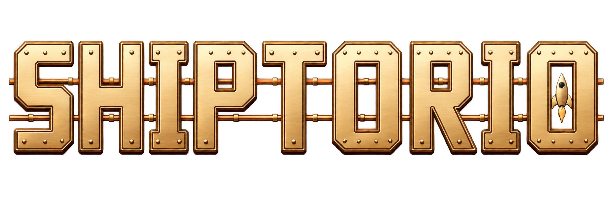
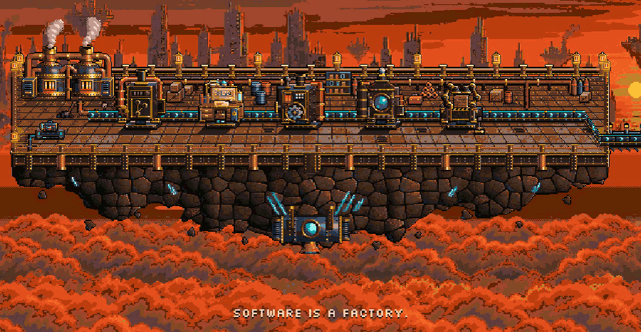

<p align="center">
  
</p>

<p align="center"><strong>A game you play on top of your GitHub repo. Every move ships something real.</strong></p>

<p align="center">
  
</p>

Your issues are the raw material. They ride a pixel conveyor through a planner, a builder, the checks and a
review, and stop at the Gate. You hold **Ship it**. A real pull request merges, and a rocket goes up.

## Why

AI writes the code now. The slow part is the person: deciding what gets built, what gets checked, and
what's safe to merge. Shiptorio puts those decisions on one card at a time, makes a yes safe with checks you
can see, and rewards you for adding more of them. The more you verify, the more the factory runs on its own.

## Meet Shippy

Shippy is the robot who runs your line. **Meta Muse Wonder is Shippy's brain.** It reads your issues, plans the
change, spots the bottleneck, reviews the result and tells you what to do next. It never writes code.

The code is written by your own **Muse Code subscription**, or another coding subscription like Codex, through a
small runner on your machine. Your sign-ins are the power plants. Nothing runs on our servers but the game.

## How a fix ships

1. **Repo.** An issue arrives on the line.
2. **Planner.** Shippy proposes a plan and the files it may touch. You approve or send it back.
3. **Builder.** Your Muse Code or Codex writes the change locally and opens a pull request.
4. **Checks.** CI, lint, tests and proof checks run. Fails ride back to the planner with a scar.
5. **Review.** Shippy reads the diff and gives a verdict.
6. **Gate.** You hold **Ship it**. The PR merges for real.
7. **Launch.** Rocket.

The first few times, you approve everything. Approve the same kind of change a few times and the factory
starts doing that step without asking. Ship it always waits for a human.

## Play

- **Try it:** [shiptorio.dev](https://shiptorio.dev). Shippy walks you through a factory in about two minutes.
- **Build your own:** sign in with GitHub, pick a repo, install the runner with one line, and your first issue
  becomes your first launch. Runner setup: [docs/site/runner.md](docs/site/runner.md).

## Run it yourself

Needs [Bun](https://bun.sh) and Node 22+.

```sh
git clone https://github.com/r3dbars/shiptorio.git
cd shiptorio
bun install
bun run dev:web
```

Open [localhost:5173/deck.html](http://localhost:5173/deck.html). Add `?source=sim` for a simulated factory.
`bun run dev` starts the full Worker with a local database on [localhost:8787](http://localhost:8787).

To host it: [self-host on Cloudflare](docs/site/self-host.md) with your own GitHub App and Meta API key.
Everything else is in the [docs](docs/site/index.md). Contributing: [AGENTS.md](AGENTS.md).

## Under the hood

One Cloudflare Worker serves the game and the API. Each repo gets its own Durable Object that owns the
factory state, ticks on an alarm and streams to the browser over a websocket. GitHub events arrive through a
GitHub App. The runner dials out from your machine, works in a git worktree, and pushes a branch; the server
opens the PR. Secrets are encrypted per repo and never reach the browser or the logs.

## Built at the Meta AI Developer Hackathon

Everything here was built between Oct 26 and Nov 4, 2026, from an empty repo. Muse Wonder makes every
factory decision. Muse Code is the builder.

## License

[MIT](LICENSE). All art is original. Fonts are SIL OFL 1.1 and the music is
[CC0](web/public/music/LICENSES.md). Shiptorio is not affiliated with Wube Software or Factorio.
Security reports: [SECURITY.md](SECURITY.md).
