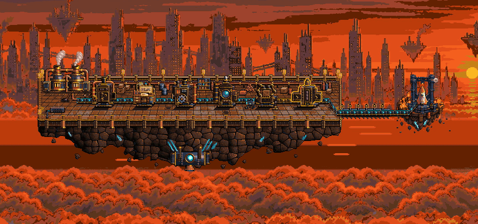
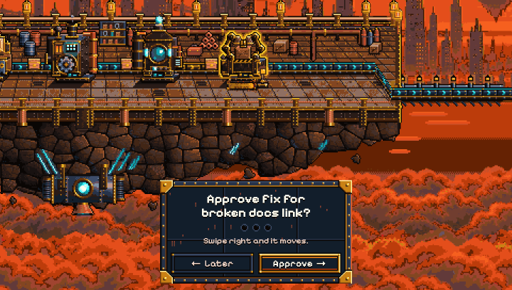
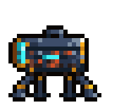
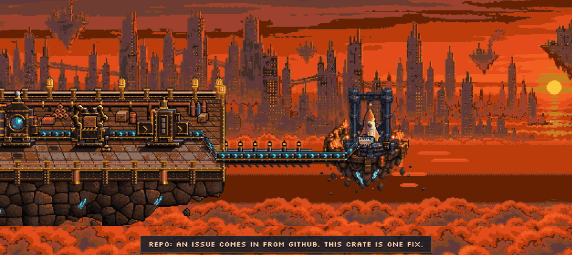
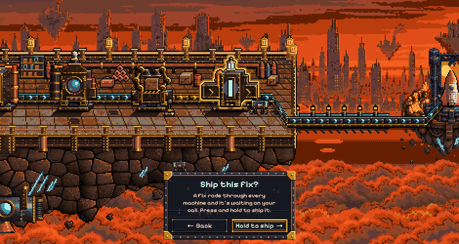
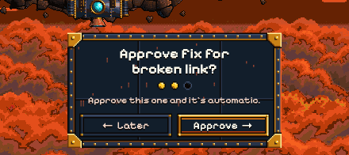
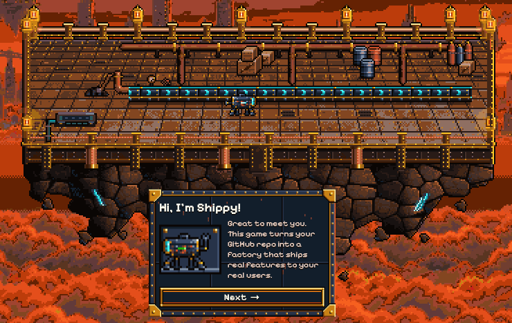
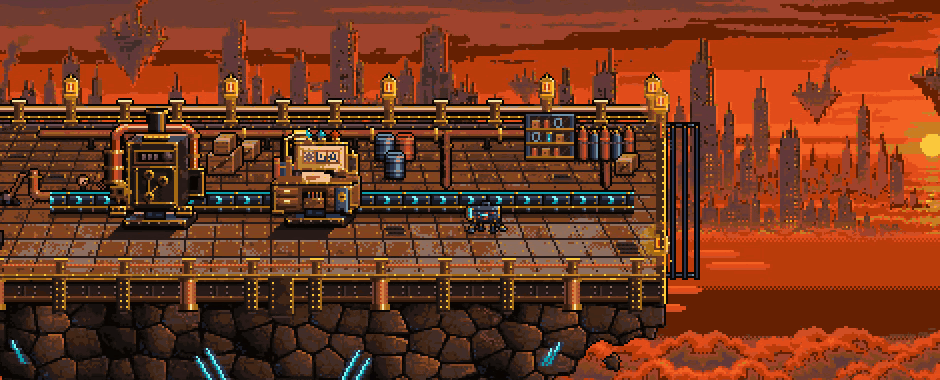
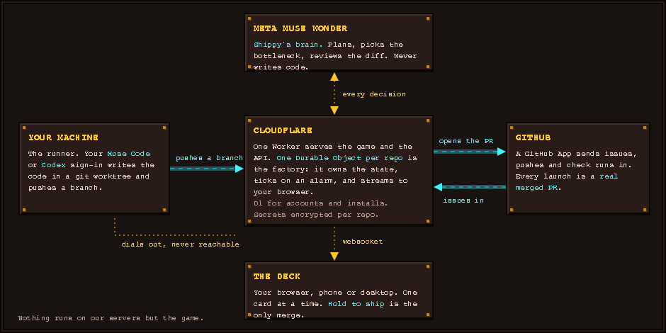
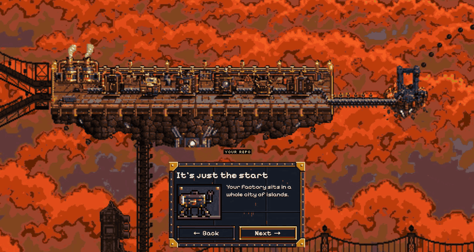

<p align="center">
  
</p>

<p align="center"><strong>A game you play on top of your GitHub repo. Every move ships something real.</strong></p>

<p align="center">
  
</p>

Your issues are the raw material. Each one rides a pixel conveyor through the Planner, the Builder, Checks
and Review, and stops at the Gate. You hold **Ship it**. A real pull request merges, and a rocket goes up.

## Why

AI writes the code now. The slow part is the person: deciding what gets built, what gets checked, and
what's safe to merge. Shiptorio puts those decisions in front of you one card at a time, makes every yes safe
with checks you can see, and rewards you for adding more checks. The more you verify, the more the factory
runs on its own.

<p align="center">
  
</p>

## Meet Shippy



Shippy is the robot who runs your line. **Meta Muse Wonder is Shippy's brain.** It reads your issues, plans the
change, spots the bottleneck, reviews the result and tells you what to do next. It never writes code.

The code is written by your own **Muse Code subscription**, or another coding subscription like Codex, through a
small runner on your machine. In the game, your sign-ins are the power plants: more of them, bigger factory.
Nothing runs on our servers but the game.

<br clear="left">

## How a fix ships

1. **Repo.** An issue arrives on the line.
2. **Planner.** Shippy proposes a plan and the files it may touch. You approve or send it back.
3. **Builder.** Your Muse Code or Codex writes the change on your machine and opens a pull request.
4. **Checks.** CI, lint and tests run on the PR. A failed check sends it back to the Planner, with a scar so you can see it was caught.
5. **Review.** Shippy reads the diff and gives a verdict.
6. **Gate.** You hold **Ship it**. The PR merges for real.
7. **Launch.** Rocket.

<p align="center">
  
</p>
<p align="center">
  
</p>

The first few times, you approve everything. Approve the same kind of change a few times and the factory
starts doing that step without asking. Ship it always waits for a human.

<p align="center">
  
</p>

## Play

- **Try it:** [shiptorio.dev](https://shiptorio.dev). Shippy walks you through a scripted factory in about two
  minutes. Nothing in the walkthrough touches a real repo.
- **Build your own:** sign in with GitHub, pick a repo, install the runner with one line, and your first issue
  becomes your first real launch. Runner setup: [docs/site/runner.md](docs/site/runner.md). During the hackathon
  this is behind a preview password.

<p align="center">
  
</p>

Your factory starts as a bare platform. Each station is built as Shippy introduces it.

<p align="center">
  
</p>

## Run it yourself

Needs [Bun](https://bun.sh) and Node 22+.

```sh
git clone https://github.com/r3dbars/shiptorio.git
cd shiptorio
bun install
bun run dev:web
```

Open [localhost:5173/deck.html](http://localhost:5173/deck.html). Add `?source=sim` for a simulated factory.
`bun run dev` starts the full Worker with a local database on [localhost:8787](http://localhost:8787).

To host it: [self-host on Cloudflare](docs/site/self-host.md) with your own GitHub App and Meta API key.
Everything else is in the [docs](docs/site/index.md). Contributing: [AGENTS.md](AGENTS.md).

## Under the hood

One Cloudflare Worker serves the game and the API. Each repo gets its own Durable Object that owns the
factory state, ticks on an alarm and streams to the browser over a websocket. GitHub events arrive through a
GitHub App. The runner dials out from your machine, works in a git worktree, and pushes a branch; the server
opens the PR. Secrets are encrypted per repo and never reach the browser or the logs.

Every decision Shippy makes is one call to the Meta Model API with a JSON schema for the answer: triage, the
plan, the bottleneck pick and the review all use the same shape, so each one is checkable and logged. The
planner and reviewer work in a small tool loop that can read files but never write them.

<p align="center">
  
</p>

## Coming soon: the rest of the city

Your software factory is the first island. It sits in a city of them, and each one will plug into your line
and feed it real work.

<p align="center">
  
</p>

- **Errors.** Sentry sends in crashes from your real product, so every bug turns into a fix on your line.
- **Traffic.** Cloudflare shows how people really use your app, so you build what they need.
- **Inbox.** Support tickets and email come in as work, straight onto your line.
- **Customers.** PostHog shows where customers drop off, so you fix what's costing you users.
- **Marketing.** Then customer acquisition and marketing, so people find what you ship.

The factory must grow.

## Built at the Meta AI Developer Hackathon

Everything here was built between Oct 26 and Nov 4, 2026, from an empty repo. Muse Wonder makes every
factory decision. Muse Code writes the code (Codex works too).

## License

[MIT](LICENSE). All art is original. Fonts are SIL OFL 1.1 and the music is
[CC0](web/public/music/LICENSES.md). Shiptorio is not affiliated with Wube Software or Factorio.
Security reports: [SECURITY.md](SECURITY.md).
