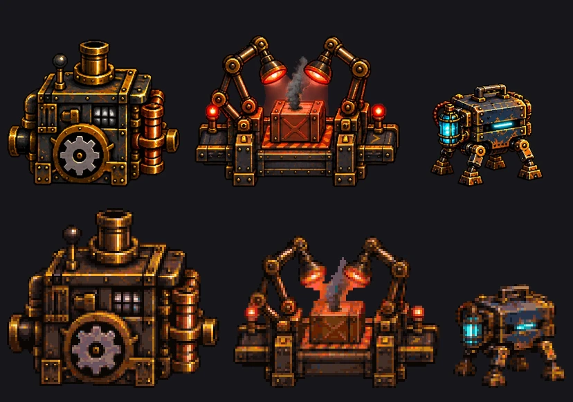
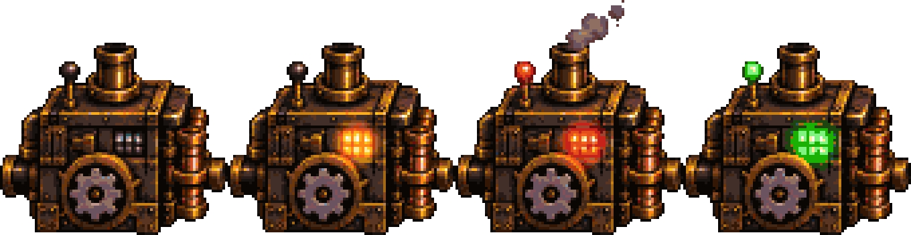
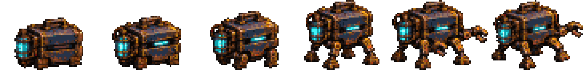
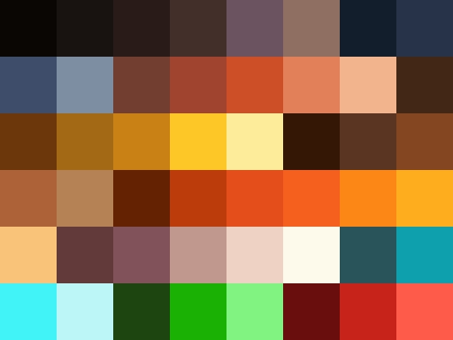

# Shiptorio pixel plan

How we turn the 2D deck into real, animated pixel art before the Nov 4 deadline. Written Oct 28, 2026 for Justin, and for ChatGPT, Codex and Claude agents to build from. Research behind it: [Pixel Art Playbook](https://claude.ai/artifact/NQCw7VMLMeFxKwKYHdnPu8).

## The plan in plain words

- **One tiny grid, one palette.** Every sprite is drawn on a small pixel grid using only 48 colors. That's what makes it all look like one game instead of pasted pictures.
- **We already tested it.** A new tool (`scripts/pixel/pixelize.py`) takes any image, ChatGPT renders included, and snaps it onto the grid and palette. Our Builder station went from 37,798 colors to 45 and now looks like a real sprite. Animation frames stay steady with no flicker.
- **ChatGPT draws, the tool cleans, code moves it.** You burn ChatGPT image credits on key frames (prompts below). The tool snaps them. Our code adds all the motion: belts, steam, sparks, shake, glow.
- **Shippy walks to whatever you tap.** Tap a machine and Shippy unfolds, walks over with a little bounce, pokes it, and it reacts.
- **No new game engine before Nov 4.** We keep our canvas and add a small pixel layer. PixiJS is the upgrade after the deadline.
- **Tonight and tomorrow:** generate all the art while your ChatGPT credits last. Codex and Claude build the code side at the same time.

## What it looks like (proof from our own art)



Builder station: idle, working, jammed, auto. Snapped from our current art, 88 pixels tall, 45 colors, frames locked so only the lights change:



Shippy unfolding, 6 frames, 44 pixels tall:



## 1. The pixel contract

This is the rulebook. Every asset, effect and line of drawing code follows it. If something breaks a rule, it gets fixed or cut.

### Grid and scale

| Rule | Value | Why |
|---|---|---|
| Art pixel | **1 art pixel = 2 world units** | World coordinates in `contract.ts` stay exactly as they are (deck is 2039 world units wide, so about 1020 art pixels). Nobody has to move a station. |
| Sprite drawing | Every sprite is drawn at exactly 2× its PNG size in world units, at even world coordinates | Keeps every pixel the same size on screen. |
| Screen scale | Each art pixel is a whole number of device pixels, **k ≥ 2** | Desktop "see it all" lands around k = 2. Phone parked on a stop lands around k = 2 to 3. Never a fraction at rest. |
| Smoothing | Off, everywhere (`imageSmoothingEnabled = false`, CSS `image-rendering: pixelated`) | Smoothing is what blurs pixels into mush. |
| Rotation and free scaling | Not allowed on sprites | Rotating pixel art smears it. Anything that turns (gears, crane) gets frames. Belts on slopes get their own tiles. |
| Camera | Snaps to whole art pixels when it stops moving | No shimmering edges at rest. While zooming, k may step. That's fine. |

### Sizes (in art pixels)

| Thing | Frame size | Notes |
|---|---|---|
| Station (repo, planner, builder, checks, review, gate) | up to 112 × 96 | Visible body about 80 to 90 tall. Feet on the bottom row, centered. |
| Shippy | 56 × 48 | Standing body about 44 tall. Folded box about 34 × 26. |
| Crate | 20 × 20 | Sits on the belt. |
| Belt tile | 32 × 16 | Seamless left to right. |
| Lever | 16 × 24 | |
| Lamp post | 8 × 20 | |
| Beacon | 12 × 24 | |
| Rocket | 40 × 96 | Flame 16 × 32, separate. |
| Boiler | 64 × 64 | |
| Deck (small / medium / large) | about 520 / 760 / 1020 wide, 330 tall | Keep current deck images snapped for now. Tile set is a later upgrade. |
| Launch island, bridge, tower | snapped from current art at half size | |
| Sky | 800 × 450 | Drawn in screen space behind everything. |
| Cloud strips | 512 × 96, three layers | Seamless left to right. |
| City skyline | 1024 × 160 | Far parallax layer. |
| Effects (steam, spark, dust, check pop) | 8 × 8 to 24 × 24 | Mostly drawn by code (section 5). |
| UI frames (card, buttons) | 9-slice, 24 × 24 with 8 pixel corners | Drawn by the DOM at a whole-number scale. |

### Palette: Black Iron 48

Sampled from Justin's four Black Iron mockups, then grouped into ramps (dark to light). Files: `art/palette/black-iron-48.hex` (order matters), `.gpl` (Aseprite, GIMP), `.json` (names), `.png` (1 pixel per color). Attach `docs/pixel/palette-swatch.png` to every ChatGPT prompt.



| Ramp | Colors, dark to light | Used for |
|---|---|---|
| `soot` (1) | `#0a0604` | Outlines, deepest shadow |
| `iron` (5) | `#181211` `#291b17` `#432f29` `#6b5360` `#8f6f62` | Riveted iron bodies, deck plates in shade |
| `steel` (4) | `#121e2b` `#273349` `#3d4d6a` `#7d8ea3` | Shippy's body, cool metal panels |
| `copper` (5) | `#713e30` `#a04430` `#cd4f27` `#e28059` `#f2b48c` | Pipes, rust, warm metal |
| `brass` (6) | `#422616` `#6d370c` `#a36915` `#c98115` `#fdc727` `#fdec9a` | Trim, rivets, gears, highlights |
| `plate` (5) | `#351705` `#5a3521` `#834621` `#ae6237` `#b48254` | Deck floor, wood, crates |
| `sun` (7) | `#652203` `#bc3c0b` `#e44e1b` `#f6601f` `#fc8717` `#fdad1e` `#f9c47a` | Sky, sunset rim light, fire, lamps |
| `haze` (4) | `#623a3a` `#82525a` `#c0988e` `#eed3c5` | Clouds, smoke, far city |
| `white` (1) | `#fdfaec` | Brightest sparks and glints only |
| `energy` (4) | `#28545a` `#0ea0ac` `#41f3f7` `#bcf6f6` | Shippy's eye, power core, scan beam |
| `ok` (3) | `#1c450f` `#1ab004` `#81f381` | Done and automatic only |
| `jam` (3) | `#6a0d0d` `#c8231b` `#ff5b4a` | Jammed and stuck only |

**Color rules**

- Only these 48 colors. Transparency is fully on or fully off. No half-see-through pixels in sprites.
- The one exception is the **light layer** (glows, steam fade, smoke). It may use palette colors at 25%, 50% or 75% opacity, drawn on top. Never gradients.
- `jam` reds are only for jammed or stuck things. `ok` greens are only for done or automatic. `energy` cyan is only for Shippy's eye, the core and power. That way color always means something.
- An "auto" version of a station is the working sprite with jam red lamps swapped to ok green by the tool (a palette swap). No new drawing needed.

### Light and outlines

- **Main light comes from the upper right** (the setting sun in the mockups). The top and right faces get the lightest ramp colors. The bottom and left faces get the darkest ones. Shadows fall down and to the left.
- **Warm rim light:** a 1 pixel `sun-3` or `brass-4` edge on right-facing edges of metal. This is the sunset look.
- **Outlines:** 1 pixel `soot` (#0a0604) around the outside of every sprite that sits on the deck. Inside lines use the darkest color of that material's ramp, not soot. This is called selective outlining and it keeps things from looking like coloring-book art.
- **Lamps and screens** are the only things allowed to glow. They get a light-layer glow (25% or 50% `sun-4` or `energy-2`).
- **No dithering** on sprites, except smoke and clouds, where a 2-color checker is fine.

### Animation rules

- Few frames. Idle 2 frames, working 4, jammed 2, walk 6. Played at 4 to 10 frames per second. Low frame rates are part of the look.
- Every frame of one object has the same size and the same anchor (feet, bottom center). The tool enforces this.
- Big moves use smear frames (a stretched blur shape in palette colors), not in-between frames.
- Motion that is just "move this thing around" (bob, shake, slide, rise) is done in code by whole art pixels, not drawn as frames.

## 2. The full asset list

Each object is one sprite sheet: frames in a row, plus a JSON file with named tags (`idle`, `working`, and so on) in Aseprite's format. Our tool writes exactly that format.

**Naming:** `web/public/deck/px/<group>/<object>.png` + `<object>.json`. Tags inside the JSON are the states. Raw ChatGPT images go in `art/raw/<object>/<tag>-<n>.png` so we can re-run the tool any time. Example: `web/public/deck/px/stations/builder.png` with tags `idle`, `working`, `jammed`, `poke`, and `auto` made by palette swap.

### Stations (6 objects)

Repo, Planner, Builder, Checks, Review, Gate. Each one:

| Tag | Frames | FPS | What moves |
|---|---|---|---|
| `idle` | 2 | 2 | A lamp blinks, maybe one small light. |
| `working` | 4 | 8 | Its main part: gear turns (Builder), arm stamps (Checks), lens scans (Review), gate bars slide (Gate), pages flip (Planner), crate chute opens (Repo). |
| `jammed` | 2 | 4 | Red lamp on, a part stuck mid-way. Shake and steam come from code. |
| `poke` | 3 | 10 | Reaction when Shippy touches it (hatch pops open, panel lights up). For tap-to-interact. |
| `auto` | 4 | 8 | Palette swap of `working`, red to green. Free. |

6 × 11 drawn frames = **66 frames**.

### Shippy (1 object, the only character)

| Tag | Frames | FPS | Notes |
|---|---|---|---|
| `folded` | 2 | 2 | Closed box, eye slit pulses. Lives in the top-left corner. |
| `unfold` | 6 | 12 | Box to standing. Folding back plays it in reverse. Already exists, snapped. |
| `idle` | 4 | 6 | Standing, slight bob, blink. |
| `walk` | 6 | 12 | Facing right. Left is the same frames mirrored. |
| `skid` | 2 | 10 | Stopping, leans back. |
| `inspect` | 4 | 8 | Leans in, cyan scan beam from the eye. |
| `poke` | 3 | 10 | Arm out, taps a button. |
| `weld` | 4 | 12 | Arm torch, sparks from code. |
| `lever` | 4 | 8 | Pulls the big lever. |
| `carry` | 6 | 12 | Walking with a crate on top. |
| `happy` | 4 | 10 | Little hop, eye turns into a ^ shape. |
| `alarmed` | 3 | 10 | Jumps, eye goes red. |
| `peek` | 2 | 4 | Box lid lifts, eye peeks out. |

About **50 frames**.

### Line, props and launch

| Object | Tags (frames) |
|---|---|
| `crate` | `plain` 1, `ok` 1, `bad` 1, `wait` 2, `glow` 2, `open` 4 |
| `belt` | `run` 4 (or 1 tile scrolled in code), `slope-up` 4, `slope-down` 4 |
| `lever` | `up` 1, `down` 1, `glow` 2 |
| `lamp` | `on` 3 (flicker), `off` 1 |
| `beacon` | `on` 2 |
| `boiler` | `off` 1, `on` 4 |
| `rocket` | `idle` 1, `shake` 2 |
| `flame` | `burn` 4 |
| `plate` | 9-slice, 1 |
| `pipe` and `vent` (deck underside) | `puff` 4 |
| `core` (cyan orb under the deck) | `pulse` 4 |

About **55 frames**.

### Deck, island and sky

| Object | Notes |
|---|---|
| `deck-small`, `deck-medium`, `deck-large` | Snapped from current art. Later: a tile set (floor plate, rail, edge, underside rock) so growth is built tile by tile. |
| `grow-*`, `launch-*`, `build-*` | The growth, launch island and construction pieces other threads already made. Snapped from current art, same names. |
| `sky` | One backdrop, sun on the right, no clouds in it. |
| `clouds-far`, `clouds-mid`, `clouds-near` | Three seamless strips. |
| `skyline` | Far city with floating islands, seamless. |
| `island-float-1..3` | Small floating islands that drift far back. |

### Effects (mostly code, sprites optional)

| Effect | Made by | Frames |
|---|---|---|
| Steam puff | code (palette squares that rise and fade by stepping colors) | sprite backup 5 |
| Spark | code (1 pixel `brass-4`/`white` with gravity) | none |
| Dust (footsteps, landing) | code | sprite backup 4 |
| Weld flash | sprite | 3 |
| Check pop (station built, approve) | sprite | 4 |
| Jam "!" bubble | sprite | 2 |
| Tap ring (where you tapped) | code (1 pixel ring that grows 3 steps) | none |
| Glows | light layer, pre-drawn stepped circles | none |

### UI

| Piece | Notes |
|---|---|
| Card panel, buttons | 9-slice, iron with brass rivets, from current `ui-*` art snapped. |
| Font | A pixel font, Pixelify Sans, at whole-number sizes (16 or 24 CSS px). |
| Icons | 16 × 16: approve check, later clock, repo, gear, rocket. |
| Info chip (tap-to-interact) | Small riveted plate, 9-slice, shows a station's name and state. |

**Total new or redrawn frames: about 180.** At 1 to 3 ChatGPT generations per frame, plan on roughly 300 to 450 image generations. That fits in a day of credits if we skip anything that can be a palette swap, a mirror or code.

## 3. Making the art with ChatGPT

### The workflow that actually stays consistent

1. **Key frame first.** For each object, generate one key frame (usually `idle`). Attach the palette swatch and a style reference (a crop from Justin's mockup). Regenerate until it's right. Justin approves it.
2. **Every other frame is an edit of the key frame.** Upload the approved key frame and ask ChatGPT to *edit* it ("keep everything identical except..."). Never generate a new frame from scratch. Edits drift way less than fresh images.
3. **One frame per request.** Strips of 4 drift more. One frame per image, same canvas size every time.
4. **Pure green background (#00FF00).** The tool cuts it out cleanly. Ask for no shadow on the ground.
5. **Snap with the tool**, frames together, with `--lock 0.08`. Lock copies every pixel that barely changed from the key frame, so only the real motion is left. That's what kills flicker.
6. **Check it on the contact sheet** (section 4) at 1× and 4×, playing. Keep or redo.

### The snap tool

```bash
# one sprite
python3 scripts/pixel/pixelize.py art/raw/builder/idle-1.png web/public/deck/px/stations/builder-idle.png --height 88 --preview 4

# a set of frames from separate images (frame 1 is the key frame), locked so only motion changes
python3 scripts/pixel/pixelize.py art/raw/builder/working-1.png web/public/deck/px/stations/builder-working.png \
  --more art/raw/builder/working-2.png art/raw/builder/working-3.png art/raw/builder/working-4.png \
  --height 88 --lock 0.08 --name working --fps 8 --preview 4

# is a file on-contract? exits 1 if not (CI uses this)
python3 scripts/pixel/pixelize.py web/public/deck/px/stations/builder-working.png --check
```

Options: `--height` (art pixels tall), `--cell` (when the source already has big square pixels, use the source pixel size instead), `--key green|corner|alpha` (background removal), `--method mean|mode` (mean keeps detail and is the default, mode is for sources that are already blocky), `--outline` (adds the 1 pixel soot outline), `--preview N` (writes a big copy to look at).

What it does: cuts the background, finds one shared crop for all frames, shrinks by averaging each block in OKLab color space and snapping to the nearest palette color, removes lone stray pixels, makes alpha hard, locks unchanged pixels to frame 1, lines every frame up on the same bottom edge, and writes the PNG sheet plus the Aseprite-style JSON.

### The style block

It's already inside every key-frame prompt below, with the right grid size filled in. It's here so you can reuse it for anything new.

**Attach to every key-frame prompt:** `docs/pixel/palette-swatch.png` plus one style reference: `docs/pixel/ref-stations.webp` (stations and props), `docs/pixel/ref-shippy.webp` (Shippy), or `docs/pixel/ref-scene.webp` (sky, clouds, deck). Copies are in the project files under `shiptorio/pixel-plan/`.

**Attach to every edit prompt:** only the approved key frame.

```text
Pixel art game sprite in the "Black Iron" steampunk style of the attached reference image: dark riveted iron, brass and copper trim, warm sunset rim light coming from the upper right. Draw it as true low-resolution pixel art on a <W>x<H> pixel grid, then show it scaled up so every pixel is a crisp square block. Hard pixel edges only: no anti-aliasing, no blur, no gradients, no soft shadows, no noise texture. Use only colors from the attached 48-color palette. A 1-pixel near-black (#0a0604) outline around the outside of the sprite; inner lines use the darkest shade of that material, not black. 3/4 front view from slightly above, same angle as the reference. One object only, centered, its base touching the bottom of the grid. Solid pure green (#00FF00) background everywhere else, no ground shadow, no text unless asked, no border. Never use bright pure green inside the sprite.
```

### Prompts per asset

Each prompt below is complete. Paste it as is. Key frames get the palette plus the style reference; edits get only the approved key frame.

### Stations

For each station: run the key prompt until it's right, then each edit prompt once per frame (attach the key frame). Snap with `--height 88 --lock 0.08`. Save raw images as `art/raw/<station>/<tag>-<n>.png`.

<details><summary><b>Repo</b> (key + 11 edits)</summary>

**repo: key frame (idle 1)**

```text
Pixel art game sprite in the "Black Iron" steampunk style of the attached reference image: dark riveted iron, brass and copper trim, warm sunset rim light coming from the upper right. Draw it as true low-resolution pixel art on a 112x96 pixel grid, then show it scaled up so every pixel is a crisp square block. Hard pixel edges only: no anti-aliasing, no blur, no gradients, no soft shadows, no noise texture. Use only colors from the attached 48-color palette. A 1-pixel near-black (#0a0604) outline around the outside of the sprite; inner lines use the darkest shade of that material, not black. 3/4 front view from slightly above, same angle as the reference. One object only, centered, its base touching the bottom of the grid. Solid pure green (#00FF00) background everywhere else, no ground shadow, no text unless asked, no border. Never use bright pure green inside the sprite.

The object: A riveted iron storage vault with a brass plaque on the front that reads "REPO", a square crate chute with a hinged flap on its right side, and a small round lamp on top. Machine is off and quiet: lamps dark, nothing moving.
```

**repo: idle 2**

```text
Edit the attached key frame. Keep every pixel identical: same size, same position, same colors, same angle, same green #00FF00 background. Change only this: one small lamp on it glows dim orange. Hard pixel edges, palette colors only, nothing else moves.
```

**repo: working 1**

```text
Edit the attached key frame. Keep every pixel identical: same size, same position, same colors, same angle, same green #00FF00 background. Change only this: the chute flap is half open and a lamp on top glows orange. Hard pixel edges, palette colors only, nothing else moves.
```

**repo: working 2**

```text
Edit the attached key frame. Keep every pixel identical: same size, same position, same colors, same angle, same green #00FF00 background. Change only this: the chute flap is fully open, a wooden crate's corner peeks out. Hard pixel edges, palette colors only, nothing else moves.
```

**repo: working 3**

```text
Edit the attached key frame. Keep every pixel identical: same size, same position, same colors, same angle, same green #00FF00 background. Change only this: the chute flap is fully open, the crate is half out. Hard pixel edges, palette colors only, nothing else moves.
```

**repo: working 4**

```text
Edit the attached key frame. Keep every pixel identical: same size, same position, same colors, same angle, same green #00FF00 background. Change only this: the chute flap is half closed, lamp glows orange. Hard pixel edges, palette colors only, nothing else moves.
```

**repo: jammed 1**

```text
Edit the attached key frame. Keep every pixel identical: same size, same position, same colors, same angle, same green #00FF00 background. Change only this: the chute flap is stuck half open at an angle, the top lamp is red. Hard pixel edges, palette colors only, nothing else moves.
```

**repo: jammed 2**

```text
Edit the attached key frame. Keep every pixel identical: same size, same position, same colors, same angle, same green #00FF00 background. Change only this: the chute flap is stuck half open at an angle, the top lamp is red, and the red lamp is dimmer (blink frame). Hard pixel edges, palette colors only, nothing else moves.
```

**repo: poke 1**

```text
Edit the attached key frame. Keep every pixel identical: same size, same position, same colors, same angle, same green #00FF00 background. Change only this: it starts to react: the plaque's border lights up warm orange and a small hatch on top pops open, just beginning. Hard pixel edges, palette colors only, nothing else moves.
```

**repo: poke 2**

```text
Edit the attached key frame. Keep every pixel identical: same size, same position, same colors, same angle, same green #00FF00 background. Change only this: the plaque's border lights up warm orange and a small hatch on top pops open. Hard pixel edges, palette colors only, nothing else moves.
```

**repo: poke 3**

```text
Edit the attached key frame. Keep every pixel identical: same size, same position, same colors, same angle, same green #00FF00 background. Change only this: it settles back halfway. Hard pixel edges, palette colors only, nothing else moves.
```

</details>

<details><summary><b>Planner</b> (key + 11 edits)</summary>

**planner: key frame (idle 1)**

```text
Pixel art game sprite in the "Black Iron" steampunk style of the attached reference image: dark riveted iron, brass and copper trim, warm sunset rim light coming from the upper right. Draw it as true low-resolution pixel art on a 112x96 pixel grid, then show it scaled up so every pixel is a crisp square block. Hard pixel edges only: no anti-aliasing, no blur, no gradients, no soft shadows, no noise texture. Use only colors from the attached 48-color palette. A 1-pixel near-black (#0a0604) outline around the outside of the sprite; inner lines use the darkest shade of that material, not black. 3/4 front view from slightly above, same angle as the reference. One object only, centered, its base touching the bottom of the grid. Solid pure green (#00FF00) background everywhere else, no ground shadow, no text unless asked, no border. Never use bright pure green inside the sprite.

The object: A heavy iron drafting desk with a large blueprint sheet on top, a brass desk lamp on a jointed arm, and pigeonhole shelves with rolled plans on the back edge. Machine is off and quiet: lamps dark, nothing moving.
```

**planner: idle 2**

```text
Edit the attached key frame. Keep every pixel identical: same size, same position, same colors, same angle, same green #00FF00 background. Change only this: one small lamp on it glows dim orange. Hard pixel edges, palette colors only, nothing else moves.
```

**planner: working 1**

```text
Edit the attached key frame. Keep every pixel identical: same size, same position, same colors, same angle, same green #00FF00 background. Change only this: the desk lamp is on, glowing warm orange onto the blueprint. Hard pixel edges, palette colors only, nothing else moves.
```

**planner: working 2**

```text
Edit the attached key frame. Keep every pixel identical: same size, same position, same colors, same angle, same green #00FF00 background. Change only this: the blueprint's top page lifts and curls up halfway. Hard pixel edges, palette colors only, nothing else moves.
```

**planner: working 3**

```text
Edit the attached key frame. Keep every pixel identical: same size, same position, same colors, same angle, same green #00FF00 background. Change only this: the top page is flipped over to the back. Hard pixel edges, palette colors only, nothing else moves.
```

**planner: working 4**

```text
Edit the attached key frame. Keep every pixel identical: same size, same position, same colors, same angle, same green #00FF00 background. Change only this: a new blueprint lies flat, the lamp is on. Hard pixel edges, palette colors only, nothing else moves.
```

**planner: jammed 1**

```text
Edit the attached key frame. Keep every pixel identical: same size, same position, same colors, same angle, same green #00FF00 background. Change only this: the lamp is red and the blueprint is crumpled in the middle. Hard pixel edges, palette colors only, nothing else moves.
```

**planner: jammed 2**

```text
Edit the attached key frame. Keep every pixel identical: same size, same position, same colors, same angle, same green #00FF00 background. Change only this: the lamp is red and the blueprint is crumpled in the middle, and the red lamp is dimmer (blink frame). Hard pixel edges, palette colors only, nothing else moves.
```

**planner: poke 1**

```text
Edit the attached key frame. Keep every pixel identical: same size, same position, same colors, same angle, same green #00FF00 background. Change only this: it starts to react: the lamp swings toward the viewer and lights up bright, just beginning. Hard pixel edges, palette colors only, nothing else moves.
```

**planner: poke 2**

```text
Edit the attached key frame. Keep every pixel identical: same size, same position, same colors, same angle, same green #00FF00 background. Change only this: the lamp swings toward the viewer and lights up bright. Hard pixel edges, palette colors only, nothing else moves.
```

**planner: poke 3**

```text
Edit the attached key frame. Keep every pixel identical: same size, same position, same colors, same angle, same green #00FF00 background. Change only this: it settles back halfway. Hard pixel edges, palette colors only, nothing else moves.
```

</details>

<details><summary><b>Builder</b> (key + 11 edits)</summary>

**builder: key frame (idle 1)**

```text
Pixel art game sprite in the "Black Iron" steampunk style of the attached reference image: dark riveted iron, brass and copper trim, warm sunset rim light coming from the upper right. Draw it as true low-resolution pixel art on a 112x96 pixel grid, then show it scaled up so every pixel is a crisp square block. Hard pixel edges only: no anti-aliasing, no blur, no gradients, no soft shadows, no noise texture. Use only colors from the attached 48-color palette. A 1-pixel near-black (#0a0604) outline around the outside of the sprite; inner lines use the darkest shade of that material, not black. 3/4 front view from slightly above, same angle as the reference. One object only, centered, its base touching the bottom of the grid. Solid pure green (#00FF00) background everywhere else, no ground shadow, no text unless asked, no border. Never use bright pure green inside the sprite.

The object: A boxy riveted iron machine with a big steel gear on the front, a brass chimney on top, copper pipes on the right side, a small 3x2 grid window that can light up, and a little lever knob on top-left. Machine is off and quiet: lamps dark, nothing moving.
```

**builder: idle 2**

```text
Edit the attached key frame. Keep every pixel identical: same size, same position, same colors, same angle, same green #00FF00 background. Change only this: one small lamp on it glows dim orange. Hard pixel edges, palette colors only, nothing else moves.
```

**builder: working 1**

```text
Edit the attached key frame. Keep every pixel identical: same size, same position, same colors, same angle, same green #00FF00 background. Change only this: the grid window glows orange and the big gear is rotated 1/4 of one tooth clockwise. Hard pixel edges, palette colors only, nothing else moves.
```

**builder: working 2**

```text
Edit the attached key frame. Keep every pixel identical: same size, same position, same colors, same angle, same green #00FF00 background. Change only this: the window glows orange and the gear is rotated 1/2 of one tooth. Hard pixel edges, palette colors only, nothing else moves.
```

**builder: working 3**

```text
Edit the attached key frame. Keep every pixel identical: same size, same position, same colors, same angle, same green #00FF00 background. Change only this: the window glows orange and the gear is rotated 3/4 of one tooth. Hard pixel edges, palette colors only, nothing else moves.
```

**builder: working 4**

```text
Edit the attached key frame. Keep every pixel identical: same size, same position, same colors, same angle, same green #00FF00 background. Change only this: the window glows orange and the gear is back to its starting position. Hard pixel edges, palette colors only, nothing else moves.
```

**builder: jammed 1**

```text
Edit the attached key frame. Keep every pixel identical: same size, same position, same colors, same angle, same green #00FF00 background. Change only this: the grid window is red, the knob on top is red, the gear is stuck with one tooth slightly bent. Hard pixel edges, palette colors only, nothing else moves.
```

**builder: jammed 2**

```text
Edit the attached key frame. Keep every pixel identical: same size, same position, same colors, same angle, same green #00FF00 background. Change only this: the grid window is red, the knob on top is red, the gear is stuck with one tooth slightly bent, and the red lamp is dimmer (blink frame). Hard pixel edges, palette colors only, nothing else moves.
```

**builder: poke 1**

```text
Edit the attached key frame. Keep every pixel identical: same size, same position, same colors, same angle, same green #00FF00 background. Change only this: it starts to react: a small panel next to the window swings open and the window flashes bright white-orange, just beginning. Hard pixel edges, palette colors only, nothing else moves.
```

**builder: poke 2**

```text
Edit the attached key frame. Keep every pixel identical: same size, same position, same colors, same angle, same green #00FF00 background. Change only this: a small panel next to the window swings open and the window flashes bright white-orange. Hard pixel edges, palette colors only, nothing else moves.
```

**builder: poke 3**

```text
Edit the attached key frame. Keep every pixel identical: same size, same position, same colors, same angle, same green #00FF00 background. Change only this: it settles back halfway. Hard pixel edges, palette colors only, nothing else moves.
```

</details>

<details><summary><b>Checks</b> (key + 11 edits)</summary>

**checks: key frame (idle 1)**

```text
Pixel art game sprite in the "Black Iron" steampunk style of the attached reference image: dark riveted iron, brass and copper trim, warm sunset rim light coming from the upper right. Draw it as true low-resolution pixel art on a 112x96 pixel grid, then show it scaled up so every pixel is a crisp square block. Hard pixel edges only: no anti-aliasing, no blur, no gradients, no soft shadows, no noise texture. Use only colors from the attached 48-color palette. A 1-pixel near-black (#0a0604) outline around the outside of the sprite; inner lines use the darkest shade of that material, not black. 3/4 front view from slightly above, same angle as the reference. One object only, centered, its base touching the bottom of the grid. Solid pure green (#00FF00) background everywhere else, no ground shadow, no text unless asked, no border. Never use bright pure green inside the sprite.

The object: A test bench machine with two round brass gauges on the front, a row of three small bulbs, and a stamping arm above a narrow slot. Machine is off and quiet: lamps dark, nothing moving.
```

**checks: idle 2**

```text
Edit the attached key frame. Keep every pixel identical: same size, same position, same colors, same angle, same green #00FF00 background. Change only this: one small lamp on it glows dim orange. Hard pixel edges, palette colors only, nothing else moves.
```

**checks: working 1**

```text
Edit the attached key frame. Keep every pixel identical: same size, same position, same colors, same angle, same green #00FF00 background. Change only this: the stamping arm is lifted up, bulb 1 is lit orange. Hard pixel edges, palette colors only, nothing else moves.
```

**checks: working 2**

```text
Edit the attached key frame. Keep every pixel identical: same size, same position, same colors, same angle, same green #00FF00 background. Change only this: the stamping arm is halfway down, bulb 2 is lit. Hard pixel edges, palette colors only, nothing else moves.
```

**checks: working 3**

```text
Edit the attached key frame. Keep every pixel identical: same size, same position, same colors, same angle, same green #00FF00 background. Change only this: the stamping arm is pressed all the way down, bulb 3 is lit. Hard pixel edges, palette colors only, nothing else moves.
```

**checks: working 4**

```text
Edit the attached key frame. Keep every pixel identical: same size, same position, same colors, same angle, same green #00FF00 background. Change only this: the arm is halfway up again, all bulbs off. Hard pixel edges, palette colors only, nothing else moves.
```

**checks: jammed 1**

```text
Edit the attached key frame. Keep every pixel identical: same size, same position, same colors, same angle, same green #00FF00 background. Change only this: the arm is stuck halfway down, all three bulbs are red, one gauge needle is in the red. Hard pixel edges, palette colors only, nothing else moves.
```

**checks: jammed 2**

```text
Edit the attached key frame. Keep every pixel identical: same size, same position, same colors, same angle, same green #00FF00 background. Change only this: the arm is stuck halfway down, all three bulbs are red, one gauge needle is in the red, and the red lamp is dimmer (blink frame). Hard pixel edges, palette colors only, nothing else moves.
```

**checks: poke 1**

```text
Edit the attached key frame. Keep every pixel identical: same size, same position, same colors, same angle, same green #00FF00 background. Change only this: it starts to react: both gauge needles swing to the right and the three bulbs light in a row, just beginning. Hard pixel edges, palette colors only, nothing else moves.
```

**checks: poke 2**

```text
Edit the attached key frame. Keep every pixel identical: same size, same position, same colors, same angle, same green #00FF00 background. Change only this: both gauge needles swing to the right and the three bulbs light in a row. Hard pixel edges, palette colors only, nothing else moves.
```

**checks: poke 3**

```text
Edit the attached key frame. Keep every pixel identical: same size, same position, same colors, same angle, same green #00FF00 background. Change only this: it settles back halfway. Hard pixel edges, palette colors only, nothing else moves.
```

</details>

<details><summary><b>Review</b> (key + 11 edits)</summary>

**review: key frame (idle 1)**

```text
Pixel art game sprite in the "Black Iron" steampunk style of the attached reference image: dark riveted iron, brass and copper trim, warm sunset rim light coming from the upper right. Draw it as true low-resolution pixel art on a 112x96 pixel grid, then show it scaled up so every pixel is a crisp square block. Hard pixel edges only: no anti-aliasing, no blur, no gradients, no soft shadows, no noise texture. Use only colors from the attached 48-color palette. A 1-pixel near-black (#0a0604) outline around the outside of the sprite; inner lines use the darkest shade of that material, not black. 3/4 front view from slightly above, same angle as the reference. One object only, centered, its base touching the bottom of the grid. Solid pure green (#00FF00) background everywhere else, no ground shadow, no text unless asked, no border. Never use bright pure green inside the sprite.

The object: An inspection station: a low iron platform with a wooden crate on it, two jointed brass arms each holding a round lamp aimed at the crate, and small warning bulbs on the front corners. Machine is off and quiet: lamps dark, nothing moving.
```

**review: idle 2**

```text
Edit the attached key frame. Keep every pixel identical: same size, same position, same colors, same angle, same green #00FF00 background. Change only this: one small lamp on it glows dim orange. Hard pixel edges, palette colors only, nothing else moves.
```

**review: working 1**

```text
Edit the attached key frame. Keep every pixel identical: same size, same position, same colors, same angle, same green #00FF00 background. Change only this: both lamps glow orange onto the crate. Hard pixel edges, palette colors only, nothing else moves.
```

**review: working 2**

```text
Edit the attached key frame. Keep every pixel identical: same size, same position, same colors, same angle, same green #00FF00 background. Change only this: the left arm tilts in closer to the crate. Hard pixel edges, palette colors only, nothing else moves.
```

**review: working 3**

```text
Edit the attached key frame. Keep every pixel identical: same size, same position, same colors, same angle, same green #00FF00 background. Change only this: the right arm tilts in closer to the crate. Hard pixel edges, palette colors only, nothing else moves.
```

**review: working 4**

```text
Edit the attached key frame. Keep every pixel identical: same size, same position, same colors, same angle, same green #00FF00 background. Change only this: both arms are back, lamps glowing. Hard pixel edges, palette colors only, nothing else moves.
```

**review: jammed 1**

```text
Edit the attached key frame. Keep every pixel identical: same size, same position, same colors, same angle, same green #00FF00 background. Change only this: both lamps glow red and a thin line of grey smoke rises from the crate. Hard pixel edges, palette colors only, nothing else moves.
```

**review: jammed 2**

```text
Edit the attached key frame. Keep every pixel identical: same size, same position, same colors, same angle, same green #00FF00 background. Change only this: both lamps glow red and a thin line of grey smoke rises from the crate, and the red lamp is dimmer (blink frame). Hard pixel edges, palette colors only, nothing else moves.
```

**review: poke 1**

```text
Edit the attached key frame. Keep every pixel identical: same size, same position, same colors, same angle, same green #00FF00 background. Change only this: it starts to react: both arms lift up and the corner bulbs flash bright, just beginning. Hard pixel edges, palette colors only, nothing else moves.
```

**review: poke 2**

```text
Edit the attached key frame. Keep every pixel identical: same size, same position, same colors, same angle, same green #00FF00 background. Change only this: both arms lift up and the corner bulbs flash bright. Hard pixel edges, palette colors only, nothing else moves.
```

**review: poke 3**

```text
Edit the attached key frame. Keep every pixel identical: same size, same position, same colors, same angle, same green #00FF00 background. Change only this: it settles back halfway. Hard pixel edges, palette colors only, nothing else moves.
```

</details>

<details><summary><b>Gate</b> (key + 11 edits)</summary>

**gate: key frame (idle 1)**

```text
Pixel art game sprite in the "Black Iron" steampunk style of the attached reference image: dark riveted iron, brass and copper trim, warm sunset rim light coming from the upper right. Draw it as true low-resolution pixel art on a 112x96 pixel grid, then show it scaled up so every pixel is a crisp square block. Hard pixel edges only: no anti-aliasing, no blur, no gradients, no soft shadows, no noise texture. Use only colors from the attached 48-color palette. A 1-pixel near-black (#0a0604) outline around the outside of the sprite; inner lines use the darkest shade of that material, not black. 3/4 front view from slightly above, same angle as the reference. One object only, centered, its base touching the bottom of the grid. Solid pure green (#00FF00) background everywhere else, no ground shadow, no text unless asked, no border. Never use bright pure green inside the sprite.

The object: A heavy iron gate frame with brass bars that can slide up, a round signal lamp on top, and rivets all over the frame. Machine is off and quiet: lamps dark, nothing moving.
```

**gate: idle 2**

```text
Edit the attached key frame. Keep every pixel identical: same size, same position, same colors, same angle, same green #00FF00 background. Change only this: one small lamp on it glows dim orange. Hard pixel edges, palette colors only, nothing else moves.
```

**gate: working 1**

```text
Edit the attached key frame. Keep every pixel identical: same size, same position, same colors, same angle, same green #00FF00 background. Change only this: the signal lamp glows orange and the bars are raised 1/4. Hard pixel edges, palette colors only, nothing else moves.
```

**gate: working 2**

```text
Edit the attached key frame. Keep every pixel identical: same size, same position, same colors, same angle, same green #00FF00 background. Change only this: bars raised 1/2. Hard pixel edges, palette colors only, nothing else moves.
```

**gate: working 3**

```text
Edit the attached key frame. Keep every pixel identical: same size, same position, same colors, same angle, same green #00FF00 background. Change only this: bars raised 3/4. Hard pixel edges, palette colors only, nothing else moves.
```

**gate: working 4**

```text
Edit the attached key frame. Keep every pixel identical: same size, same position, same colors, same angle, same green #00FF00 background. Change only this: bars raised all the way. Hard pixel edges, palette colors only, nothing else moves.
```

**gate: jammed 1**

```text
Edit the attached key frame. Keep every pixel identical: same size, same position, same colors, same angle, same green #00FF00 background. Change only this: the bars are stuck at 1/3 height and bent, the signal lamp is red. Hard pixel edges, palette colors only, nothing else moves.
```

**gate: jammed 2**

```text
Edit the attached key frame. Keep every pixel identical: same size, same position, same colors, same angle, same green #00FF00 background. Change only this: the bars are stuck at 1/3 height and bent, the signal lamp is red, and the red lamp is dimmer (blink frame). Hard pixel edges, palette colors only, nothing else moves.
```

**gate: poke 1**

```text
Edit the attached key frame. Keep every pixel identical: same size, same position, same colors, same angle, same green #00FF00 background. Change only this: it starts to react: the signal lamp spins bright and a small sign plate flips down, just beginning. Hard pixel edges, palette colors only, nothing else moves.
```

**gate: poke 2**

```text
Edit the attached key frame. Keep every pixel identical: same size, same position, same colors, same angle, same green #00FF00 background. Change only this: the signal lamp spins bright and a small sign plate flips down. Hard pixel edges, palette colors only, nothing else moves.
```

**gate: poke 3**

```text
Edit the attached key frame. Keep every pixel identical: same size, same position, same colors, same angle, same green #00FF00 background. Change only this: it settles back halfway. Hard pixel edges, palette colors only, nothing else moves.
```

</details>

### Shippy

Attach the current Shippy art (`web/public/deck/art/shippy-3.webp`) as an extra reference. Snap with `--height 44 --lock 0.06`. Walk faces right only; code mirrors it.

<details><summary><b>Shippy</b> (key + edits, about 45 images)</summary>

**Shippy: key frame (idle 1)**

```text
Pixel art game sprite in the "Black Iron" steampunk style of the attached reference image: dark riveted iron, brass and copper trim, warm sunset rim light coming from the upper right. Draw it as true low-resolution pixel art on a 56x48 pixel grid, then show it scaled up so every pixel is a crisp square block. Hard pixel edges only: no anti-aliasing, no blur, no gradients, no soft shadows, no noise texture. Use only colors from the attached 48-color palette. A 1-pixel near-black (#0a0604) outline around the outside of the sprite; inner lines use the darkest shade of that material, not black. 3/4 front view from slightly above, same angle as the reference. One object only, centered, its base touching the bottom of the grid. Solid pure green (#00FF00) background everywhere else, no ground shadow, no text unless asked, no border. Never use bright pure green inside the sprite.

The object: Shippy, a small box-shaped robot about the size of a toolbox: blue-grey steel body with brass corner caps and rust spots, a carry handle on top, a horizontal slit eye that glows cyan, a round cyan lantern on its left side, and four short jointed brass legs. Standing still facing right, all four feet flat on the ground. Friendly, never scary. No mouth, no face other than the eye slit.
```

**Shippy: idle 2**

```text
Edit the attached key frame. Keep every pixel identical: same size, same position, same colors, same angle, same green #00FF00 background. Change only this: the eye slit is half closed (blink). Hard pixel edges, palette colors only, nothing else moves.
```

**Shippy: idle 3**

```text
Edit the attached key frame. Keep every pixel identical: same size, same position, same colors, same angle, same green #00FF00 background. Change only this: the whole body is 1 pixel lower, legs slightly bent. Hard pixel edges, palette colors only, nothing else moves.
```

**Shippy: idle 4**

```text
Edit the attached key frame. Keep every pixel identical: same size, same position, same colors, same angle, same green #00FF00 background. Change only this: the eye is fully open, body 1 pixel lower. Hard pixel edges, palette colors only, nothing else moves.
```

**Shippy: walk 1**

```text
Edit the attached key frame. Keep every pixel identical: same size, same position, same colors, same angle, same green #00FF00 background. Change only this: front-right and back-left legs step forward, the other two legs push back. Hard pixel edges, palette colors only, nothing else moves.
```

**Shippy: walk 2**

```text
Edit the attached key frame. Keep every pixel identical: same size, same position, same colors, same angle, same green #00FF00 background. Change only this: same legs as walk 1 but the body is 1 pixel lower (weight down). Hard pixel edges, palette colors only, nothing else moves.
```

**Shippy: walk 3**

```text
Edit the attached key frame. Keep every pixel identical: same size, same position, same colors, same angle, same green #00FF00 background. Change only this: all legs passing under the body, body 1 pixel higher. Hard pixel edges, palette colors only, nothing else moves.
```

**Shippy: walk 4**

```text
Edit the attached key frame. Keep every pixel identical: same size, same position, same colors, same angle, same green #00FF00 background. Change only this: front-left and back-right legs step forward, the other two push back. Hard pixel edges, palette colors only, nothing else moves.
```

**Shippy: walk 5**

```text
Edit the attached key frame. Keep every pixel identical: same size, same position, same colors, same angle, same green #00FF00 background. Change only this: same legs as walk 4, body 1 pixel lower. Hard pixel edges, palette colors only, nothing else moves.
```

**Shippy: walk 6**

```text
Edit the attached key frame. Keep every pixel identical: same size, same position, same colors, same angle, same green #00FF00 background. Change only this: all legs passing under the body, body 1 pixel higher. Hard pixel edges, palette colors only, nothing else moves.
```

**Shippy: skid 1**

```text
Edit the attached key frame. Keep every pixel identical: same size, same position, same colors, same angle, same green #00FF00 background. Change only this: leaning back, front legs braced forward, a tiny dust puff at the front feet. Hard pixel edges, palette colors only, nothing else moves.
```

**Shippy: skid 2**

```text
Edit the attached key frame. Keep every pixel identical: same size, same position, same colors, same angle, same green #00FF00 background. Change only this: leaning back less, almost upright. Hard pixel edges, palette colors only, nothing else moves.
```

**Shippy: inspect 1**

```text
Edit the attached key frame. Keep every pixel identical: same size, same position, same colors, same angle, same green #00FF00 background. Change only this: leaning forward, eye wider. Hard pixel edges, palette colors only, nothing else moves.
```

**Shippy: inspect 2**

```text
Edit the attached key frame. Keep every pixel identical: same size, same position, same colors, same angle, same green #00FF00 background. Change only this: leaning forward, a thin cyan scan beam shoots forward from the eye. Hard pixel edges, palette colors only, nothing else moves.
```

**Shippy: inspect 3**

```text
Edit the attached key frame. Keep every pixel identical: same size, same position, same colors, same angle, same green #00FF00 background. Change only this: same lean, the scan beam is wider and fans out. Hard pixel edges, palette colors only, nothing else moves.
```

**Shippy: inspect 4**

```text
Edit the attached key frame. Keep every pixel identical: same size, same position, same colors, same angle, same green #00FF00 background. Change only this: leaning forward, beam off, eye bright. Hard pixel edges, palette colors only, nothing else moves.
```

**Shippy: poke 1**

```text
Edit the attached key frame. Keep every pixel identical: same size, same position, same colors, same angle, same green #00FF00 background. Change only this: a thin jointed brass arm unfolds from the right side of the body. Hard pixel edges, palette colors only, nothing else moves.
```

**Shippy: poke 2**

```text
Edit the attached key frame. Keep every pixel identical: same size, same position, same colors, same angle, same green #00FF00 background. Change only this: the arm is stretched out straight, its tip touching something. Hard pixel edges, palette colors only, nothing else moves.
```

**Shippy: poke 3**

```text
Edit the attached key frame. Keep every pixel identical: same size, same position, same colors, same angle, same green #00FF00 background. Change only this: the arm folds halfway back. Hard pixel edges, palette colors only, nothing else moves.
```

**Shippy: weld 1**

```text
Edit the attached key frame. Keep every pixel identical: same size, same position, same colors, same angle, same green #00FF00 background. Change only this: a brass arm holds a small torch forward, a bright white-orange spark at its tip. Hard pixel edges, palette colors only, nothing else moves.
```

**Shippy: weld 2**

```text
Edit the attached key frame. Keep every pixel identical: same size, same position, same colors, same angle, same green #00FF00 background. Change only this: torch tip spark smaller. Hard pixel edges, palette colors only, nothing else moves.
```

**Shippy: weld 3**

```text
Edit the attached key frame. Keep every pixel identical: same size, same position, same colors, same angle, same green #00FF00 background. Change only this: torch tip spark big, eye squinting. Hard pixel edges, palette colors only, nothing else moves.
```

**Shippy: weld 4**

```text
Edit the attached key frame. Keep every pixel identical: same size, same position, same colors, same angle, same green #00FF00 background. Change only this: torch tip spark tiny. Hard pixel edges, palette colors only, nothing else moves.
```

**Shippy: lever 1**

```text
Edit the attached key frame. Keep every pixel identical: same size, same position, same colors, same angle, same green #00FF00 background. Change only this: the arm reaches up to grab a lever handle above and in front. Hard pixel edges, palette colors only, nothing else moves.
```

**Shippy: lever 2**

```text
Edit the attached key frame. Keep every pixel identical: same size, same position, same colors, same angle, same green #00FF00 background. Change only this: pulling: body leans back, arm stretched. Hard pixel edges, palette colors only, nothing else moves.
```

**Shippy: lever 3**

```text
Edit the attached key frame. Keep every pixel identical: same size, same position, same colors, same angle, same green #00FF00 background. Change only this: pulling hard: body low, arm down. Hard pixel edges, palette colors only, nothing else moves.
```

**Shippy: lever 4**

```text
Edit the attached key frame. Keep every pixel identical: same size, same position, same colors, same angle, same green #00FF00 background. Change only this: lever down, body upright, eye bright. Hard pixel edges, palette colors only, nothing else moves.
```

**Shippy: carry 1**

```text
Edit the attached key frame. Keep every pixel identical: same size, same position, same colors, same angle, same green #00FF00 background. Change only this: a small wooden crate rests on top of the body between the handle, legs as in walk 1. Hard pixel edges, palette colors only, nothing else moves.
```

**Shippy: carry 2**

```text
Edit the attached key frame. Keep every pixel identical: same size, same position, same colors, same angle, same green #00FF00 background. Change only this: with the crate on top, legs as in walk 2. Hard pixel edges, palette colors only, nothing else moves.
```

**Shippy: carry 3**

```text
Edit the attached key frame. Keep every pixel identical: same size, same position, same colors, same angle, same green #00FF00 background. Change only this: crate on top, legs as in walk 3. Hard pixel edges, palette colors only, nothing else moves.
```

**Shippy: carry 4**

```text
Edit the attached key frame. Keep every pixel identical: same size, same position, same colors, same angle, same green #00FF00 background. Change only this: crate on top, legs as in walk 4. Hard pixel edges, palette colors only, nothing else moves.
```

**Shippy: carry 5**

```text
Edit the attached key frame. Keep every pixel identical: same size, same position, same colors, same angle, same green #00FF00 background. Change only this: crate on top, legs as in walk 5. Hard pixel edges, palette colors only, nothing else moves.
```

**Shippy: carry 6**

```text
Edit the attached key frame. Keep every pixel identical: same size, same position, same colors, same angle, same green #00FF00 background. Change only this: crate on top, legs as in walk 6. Hard pixel edges, palette colors only, nothing else moves.
```

**Shippy: happy 1**

```text
Edit the attached key frame. Keep every pixel identical: same size, same position, same colors, same angle, same green #00FF00 background. Change only this: crouched low, eye is a happy upside-down V shape. Hard pixel edges, palette colors only, nothing else moves.
```

**Shippy: happy 2**

```text
Edit the attached key frame. Keep every pixel identical: same size, same position, same colors, same angle, same green #00FF00 background. Change only this: jumping: all feet 3 pixels off the ground, eye happy. Hard pixel edges, palette colors only, nothing else moves.
```

**Shippy: happy 3**

```text
Edit the attached key frame. Keep every pixel identical: same size, same position, same colors, same angle, same green #00FF00 background. Change only this: top of the jump: feet 5 pixels up. Hard pixel edges, palette colors only, nothing else moves.
```

**Shippy: happy 4**

```text
Edit the attached key frame. Keep every pixel identical: same size, same position, same colors, same angle, same green #00FF00 background. Change only this: landing: body squashed 2 pixels. Hard pixel edges, palette colors only, nothing else moves.
```

**Shippy: alarmed 1**

```text
Edit the attached key frame. Keep every pixel identical: same size, same position, same colors, same angle, same green #00FF00 background. Change only this: eye glows red and wide, body jumps 2 pixels. Hard pixel edges, palette colors only, nothing else moves.
```

**Shippy: alarmed 2**

```text
Edit the attached key frame. Keep every pixel identical: same size, same position, same colors, same angle, same green #00FF00 background. Change only this: eye red, legs splayed out. Hard pixel edges, palette colors only, nothing else moves.
```

**Shippy: alarmed 3**

```text
Edit the attached key frame. Keep every pixel identical: same size, same position, same colors, same angle, same green #00FF00 background. Change only this: eye red, body back down. Hard pixel edges, palette colors only, nothing else moves.
```

**Shippy: folded 1 (key for the box)**

```text
Pixel art game sprite in the "Black Iron" steampunk style of the attached reference image: dark riveted iron, brass and copper trim, warm sunset rim light coming from the upper right. Draw it as true low-resolution pixel art on a 40x32 pixel grid, then show it scaled up so every pixel is a crisp square block. Hard pixel edges only: no anti-aliasing, no blur, no gradients, no soft shadows, no noise texture. Use only colors from the attached 48-color palette. A 1-pixel near-black (#0a0604) outline around the outside of the sprite; inner lines use the darkest shade of that material, not black. 3/4 front view from slightly above, same angle as the reference. One object only, centered, its base touching the bottom of the grid. Solid pure green (#00FF00) background everywhere else, no ground shadow, no text unless asked, no border. Never use bright pure green inside the sprite.

The object: Shippy folded up into a closed box: blue-grey steel box with brass corner caps, rust spots, carry handle on top, legs tucked away so it looks like a plain toolbox. The eye slit is a thin dark line with a faint cyan glow.
```

**Shippy: folded 2**

```text
Edit the attached key frame. Keep every pixel identical: same size, same position, same colors, same angle, same green #00FF00 background. Change only this: the eye slit glows a little brighter cyan. Hard pixel edges, palette colors only, nothing else moves.
```

**Shippy: peek 1**

```text
Edit the attached key frame. Keep every pixel identical: same size, same position, same colors, same angle, same green #00FF00 background. Change only this: the lid lifts 2 pixels and a cyan eye peeks out from the gap. Hard pixel edges, palette colors only, nothing else moves.
```

**Shippy: peek 2**

```text
Edit the attached key frame. Keep every pixel identical: same size, same position, same colors, same angle, same green #00FF00 background. Change only this: the lid lifts 3 pixels, the eye looks to the right. Hard pixel edges, palette colors only, nothing else moves.
```

</details>

### Line, props and launch

<details><summary><b>Crate, belt, lever, lamp, beacon, boiler, rocket, flame, core, vent</b></summary>

**crate: key frame**

```text
Pixel art game sprite in the "Black Iron" steampunk style of the attached reference image: dark riveted iron, brass and copper trim, warm sunset rim light coming from the upper right. Draw it as true low-resolution pixel art on a 20x20 pixel grid, then show it scaled up so every pixel is a crisp square block. Hard pixel edges only: no anti-aliasing, no blur, no gradients, no soft shadows, no noise texture. Use only colors from the attached 48-color palette. A 1-pixel near-black (#0a0604) outline around the outside of the sprite; inner lines use the darkest shade of that material, not black. 3/4 front view from slightly above, same angle as the reference. One object only, centered, its base touching the bottom of the grid. Solid pure green (#00FF00) background everywhere else, no ground shadow, no text unless asked, no border. Never use bright pure green inside the sprite.

The object: A small wooden shipping crate with iron corner brackets and an X brace on the front.
```

**crate: ok**

```text
Edit the attached key frame. Keep every pixel identical: same size, same position, same colors, same angle, same green #00FF00 background. Change only this: a small green check mark is stamped on the front. Hard pixel edges, palette colors only, nothing else moves.
```

**crate: bad**

```text
Edit the attached key frame. Keep every pixel identical: same size, same position, same colors, same angle, same green #00FF00 background. Change only this: a red X is stamped on the front. Hard pixel edges, palette colors only, nothing else moves.
```

**crate: wait 1**

```text
Edit the attached key frame. Keep every pixel identical: same size, same position, same colors, same angle, same green #00FF00 background. Change only this: red-and-dark warning bands are painted around it. Hard pixel edges, palette colors only, nothing else moves.
```

**crate: wait 2**

```text
Edit the attached key frame. Keep every pixel identical: same size, same position, same colors, same angle, same green #00FF00 background. Change only this: warning bands brighter red (blink frame). Hard pixel edges, palette colors only, nothing else moves.
```

**crate: glow 1**

```text
Edit the attached key frame. Keep every pixel identical: same size, same position, same colors, same angle, same green #00FF00 background. Change only this: its edges glow warm orange. Hard pixel edges, palette colors only, nothing else moves.
```

**crate: glow 2**

```text
Edit the attached key frame. Keep every pixel identical: same size, same position, same colors, same angle, same green #00FF00 background. Change only this: edges glow brighter. Hard pixel edges, palette colors only, nothing else moves.
```

**crate: open 1**

```text
Edit the attached key frame. Keep every pixel identical: same size, same position, same colors, same angle, same green #00FF00 background. Change only this: the lid pops up 2 pixels. Hard pixel edges, palette colors only, nothing else moves.
```

**crate: open 2**

```text
Edit the attached key frame. Keep every pixel identical: same size, same position, same colors, same angle, same green #00FF00 background. Change only this: lid tilted open. Hard pixel edges, palette colors only, nothing else moves.
```

**crate: open 3**

```text
Edit the attached key frame. Keep every pixel identical: same size, same position, same colors, same angle, same green #00FF00 background. Change only this: lid fully open, warm light from inside. Hard pixel edges, palette colors only, nothing else moves.
```

**crate: open 4**

```text
Edit the attached key frame. Keep every pixel identical: same size, same position, same colors, same angle, same green #00FF00 background. Change only this: lid falls back closed. Hard pixel edges, palette colors only, nothing else moves.
```

**belt: key frame**

```text
Pixel art game sprite in the "Black Iron" steampunk style of the attached reference image: dark riveted iron, brass and copper trim, warm sunset rim light coming from the upper right. Draw it as true low-resolution pixel art on a 32x16 pixel grid, then show it scaled up so every pixel is a crisp square block. Hard pixel edges only: no anti-aliasing, no blur, no gradients, no soft shadows, no noise texture. Use only colors from the attached 48-color palette. A 1-pixel near-black (#0a0604) outline around the outside of the sprite; inner lines use the darkest shade of that material, not black. 3/4 front view from slightly above, same angle as the reference. One object only, centered, its base touching the bottom of the grid. Solid pure green (#00FF00) background everywhere else, no ground shadow, no text unless asked, no border. Never use bright pure green inside the sprite.

The object: One seamless tile of a conveyor belt seen from the front at the same angle: dark rubber belt with yellow chevron arrows pointing right, iron side rails with rivets, small rollers underneath. The left and right edges must tile seamlessly.
```

**belt: run 2**

```text
Edit the attached key frame. Keep every pixel identical: same size, same position, same colors, same angle, same green #00FF00 background. Change only this: the chevrons and belt texture shifted 2 pixels to the right. Hard pixel edges, palette colors only, nothing else moves.
```

**belt: run 3**

```text
Edit the attached key frame. Keep every pixel identical: same size, same position, same colors, same angle, same green #00FF00 background. Change only this: shifted 4 pixels to the right. Hard pixel edges, palette colors only, nothing else moves.
```

**belt: run 4**

```text
Edit the attached key frame. Keep every pixel identical: same size, same position, same colors, same angle, same green #00FF00 background. Change only this: shifted 6 pixels to the right. Hard pixel edges, palette colors only, nothing else moves.
```

**lever: key frame**

```text
Pixel art game sprite in the "Black Iron" steampunk style of the attached reference image: dark riveted iron, brass and copper trim, warm sunset rim light coming from the upper right. Draw it as true low-resolution pixel art on a 16x24 pixel grid, then show it scaled up so every pixel is a crisp square block. Hard pixel edges only: no anti-aliasing, no blur, no gradients, no soft shadows, no noise texture. Use only colors from the attached 48-color palette. A 1-pixel near-black (#0a0604) outline around the outside of the sprite; inner lines use the darkest shade of that material, not black. 3/4 front view from slightly above, same angle as the reference. One object only, centered, its base touching the bottom of the grid. Solid pure green (#00FF00) background everywhere else, no ground shadow, no text unless asked, no border. Never use bright pure green inside the sprite.

The object: A big floor lever on an iron base with a brass handle and a red knob, pointing up.
```

**lever: down**

```text
Edit the attached key frame. Keep every pixel identical: same size, same position, same colors, same angle, same green #00FF00 background. Change only this: the lever points down toward the front. Hard pixel edges, palette colors only, nothing else moves.
```

**lever: glow 1**

```text
Edit the attached key frame. Keep every pixel identical: same size, same position, same colors, same angle, same green #00FF00 background. Change only this: lever up, the knob glows bright orange. Hard pixel edges, palette colors only, nothing else moves.
```

**lever: glow 2**

```text
Edit the attached key frame. Keep every pixel identical: same size, same position, same colors, same angle, same green #00FF00 background. Change only this: knob glow dimmer. Hard pixel edges, palette colors only, nothing else moves.
```

**lamp: key frame**

```text
Pixel art game sprite in the "Black Iron" steampunk style of the attached reference image: dark riveted iron, brass and copper trim, warm sunset rim light coming from the upper right. Draw it as true low-resolution pixel art on a 8x20 pixel grid, then show it scaled up so every pixel is a crisp square block. Hard pixel edges only: no anti-aliasing, no blur, no gradients, no soft shadows, no noise texture. Use only colors from the attached 48-color palette. A 1-pixel near-black (#0a0604) outline around the outside of the sprite; inner lines use the darkest shade of that material, not black. 3/4 front view from slightly above, same angle as the reference. One object only, centered, its base touching the bottom of the grid. Solid pure green (#00FF00) background everywhere else, no ground shadow, no text unless asked, no border. Never use bright pure green inside the sprite.

The object: A tall thin brass lamp post with a small glass lantern on top glowing warm orange.
```

**lamp: on 2**

```text
Edit the attached key frame. Keep every pixel identical: same size, same position, same colors, same angle, same green #00FF00 background. Change only this: the lantern glow is a bit dimmer. Hard pixel edges, palette colors only, nothing else moves.
```

**lamp: on 3**

```text
Edit the attached key frame. Keep every pixel identical: same size, same position, same colors, same angle, same green #00FF00 background. Change only this: the lantern glow is a bit brighter. Hard pixel edges, palette colors only, nothing else moves.
```

**lamp: off**

```text
Edit the attached key frame. Keep every pixel identical: same size, same position, same colors, same angle, same green #00FF00 background. Change only this: the lantern is dark. Hard pixel edges, palette colors only, nothing else moves.
```

**beacon: key frame**

```text
Pixel art game sprite in the "Black Iron" steampunk style of the attached reference image: dark riveted iron, brass and copper trim, warm sunset rim light coming from the upper right. Draw it as true low-resolution pixel art on a 12x24 pixel grid, then show it scaled up so every pixel is a crisp square block. Hard pixel edges only: no anti-aliasing, no blur, no gradients, no soft shadows, no noise texture. Use only colors from the attached 48-color palette. A 1-pixel near-black (#0a0604) outline around the outside of the sprite; inner lines use the darkest shade of that material, not black. 3/4 front view from slightly above, same angle as the reference. One object only, centered, its base touching the bottom of the grid. Solid pure green (#00FF00) background everywhere else, no ground shadow, no text unless asked, no border. Never use bright pure green inside the sprite.

The object: A small warning beacon on a brass stand with a round amber glass dome.
```

**beacon: on 2**

```text
Edit the attached key frame. Keep every pixel identical: same size, same position, same colors, same angle, same green #00FF00 background. Change only this: the dome glows bright amber. Hard pixel edges, palette colors only, nothing else moves.
```

**boiler: key frame**

```text
Pixel art game sprite in the "Black Iron" steampunk style of the attached reference image: dark riveted iron, brass and copper trim, warm sunset rim light coming from the upper right. Draw it as true low-resolution pixel art on a 64x64 pixel grid, then show it scaled up so every pixel is a crisp square block. Hard pixel edges only: no anti-aliasing, no blur, no gradients, no soft shadows, no noise texture. Use only colors from the attached 48-color palette. A 1-pixel near-black (#0a0604) outline around the outside of the sprite; inner lines use the darkest shade of that material, not black. 3/4 front view from slightly above, same angle as the reference. One object only, centered, its base touching the bottom of the grid. Solid pure green (#00FF00) background everywhere else, no ground shadow, no text unless asked, no border. Never use bright pure green inside the sprite.

The object: A big round riveted iron boiler tank with brass bands, a pressure gauge, a small fire window at the bottom, and a chimney pipe.
```

**boiler: on 1**

```text
Edit the attached key frame. Keep every pixel identical: same size, same position, same colors, same angle, same green #00FF00 background. Change only this: the fire window glows orange. Hard pixel edges, palette colors only, nothing else moves.
```

**boiler: on 2**

```text
Edit the attached key frame. Keep every pixel identical: same size, same position, same colors, same angle, same green #00FF00 background. Change only this: fire window brighter, gauge needle moved right. Hard pixel edges, palette colors only, nothing else moves.
```

**boiler: on 3**

```text
Edit the attached key frame. Keep every pixel identical: same size, same position, same colors, same angle, same green #00FF00 background. Change only this: fire window glows orange, needle back. Hard pixel edges, palette colors only, nothing else moves.
```

**boiler: on 4**

```text
Edit the attached key frame. Keep every pixel identical: same size, same position, same colors, same angle, same green #00FF00 background. Change only this: fire window bright yellow-orange. Hard pixel edges, palette colors only, nothing else moves.
```

**rocket: key frame**

```text
Pixel art game sprite in the "Black Iron" steampunk style of the attached reference image: dark riveted iron, brass and copper trim, warm sunset rim light coming from the upper right. Draw it as true low-resolution pixel art on a 40x96 pixel grid, then show it scaled up so every pixel is a crisp square block. Hard pixel edges only: no anti-aliasing, no blur, no gradients, no soft shadows, no noise texture. Use only colors from the attached 48-color palette. A 1-pixel near-black (#0a0604) outline around the outside of the sprite; inner lines use the darkest shade of that material, not black. 3/4 front view from slightly above, same angle as the reference. One object only, centered, its base touching the bottom of the grid. Solid pure green (#00FF00) background everywhere else, no ground shadow, no text unless asked, no border. Never use bright pure green inside the sprite.

The object: A small retro rocket standing upright: white and cream hull with copper rivets, a round porthole, red fins, a pointed red nose cone.
```

**rocket: shake 1**

```text
Edit the attached key frame. Keep every pixel identical: same size, same position, same colors, same angle, same green #00FF00 background. Change only this: the rocket is shifted 1 pixel left. Hard pixel edges, palette colors only, nothing else moves.
```

**rocket: shake 2**

```text
Edit the attached key frame. Keep every pixel identical: same size, same position, same colors, same angle, same green #00FF00 background. Change only this: shifted 1 pixel right. Hard pixel edges, palette colors only, nothing else moves.
```

**flame: key frame**

```text
Pixel art game sprite in the "Black Iron" steampunk style of the attached reference image: dark riveted iron, brass and copper trim, warm sunset rim light coming from the upper right. Draw it as true low-resolution pixel art on a 16x32 pixel grid, then show it scaled up so every pixel is a crisp square block. Hard pixel edges only: no anti-aliasing, no blur, no gradients, no soft shadows, no noise texture. Use only colors from the attached 48-color palette. A 1-pixel near-black (#0a0604) outline around the outside of the sprite; inner lines use the darkest shade of that material, not black. 3/4 front view from slightly above, same angle as the reference. One object only, centered, its base touching the bottom of the grid. Solid pure green (#00FF00) background everywhere else, no ground shadow, no text unless asked, no border. Never use bright pure green inside the sprite.

The object: A rocket exhaust flame pointing down: white-yellow core, orange middle, red edges, pixel art flame shape.
```

**flame: burn 2**

```text
Edit the attached key frame. Keep every pixel identical: same size, same position, same colors, same angle, same green #00FF00 background. Change only this: the flame is 3 pixels longer and its tip flickers left. Hard pixel edges, palette colors only, nothing else moves.
```

**flame: burn 3**

```text
Edit the attached key frame. Keep every pixel identical: same size, same position, same colors, same angle, same green #00FF00 background. Change only this: flame shorter, tip right. Hard pixel edges, palette colors only, nothing else moves.
```

**flame: burn 4**

```text
Edit the attached key frame. Keep every pixel identical: same size, same position, same colors, same angle, same green #00FF00 background. Change only this: flame longest, tip split in two. Hard pixel edges, palette colors only, nothing else moves.
```

**core: key frame**

```text
Pixel art game sprite in the "Black Iron" steampunk style of the attached reference image: dark riveted iron, brass and copper trim, warm sunset rim light coming from the upper right. Draw it as true low-resolution pixel art on a 32x32 pixel grid, then show it scaled up so every pixel is a crisp square block. Hard pixel edges only: no anti-aliasing, no blur, no gradients, no soft shadows, no noise texture. Use only colors from the attached 48-color palette. A 1-pixel near-black (#0a0604) outline around the outside of the sprite; inner lines use the darkest shade of that material, not black. 3/4 front view from slightly above, same angle as the reference. One object only, centered, its base touching the bottom of the grid. Solid pure green (#00FF00) background everywhere else, no ground shadow, no text unless asked, no border. Never use bright pure green inside the sprite.

The object: A round glass power orb in a brass cage, glowing cyan inside, hanging under a floating deck.
```

**core: pulse 2**

```text
Edit the attached key frame. Keep every pixel identical: same size, same position, same colors, same angle, same green #00FF00 background. Change only this: cyan glow brighter. Hard pixel edges, palette colors only, nothing else moves.
```

**core: pulse 3**

```text
Edit the attached key frame. Keep every pixel identical: same size, same position, same colors, same angle, same green #00FF00 background. Change only this: brightest, tiny white center. Hard pixel edges, palette colors only, nothing else moves.
```

**core: pulse 4**

```text
Edit the attached key frame. Keep every pixel identical: same size, same position, same colors, same angle, same green #00FF00 background. Change only this: glow dimmer. Hard pixel edges, palette colors only, nothing else moves.
```

**vent: key frame**

```text
Pixel art game sprite in the "Black Iron" steampunk style of the attached reference image: dark riveted iron, brass and copper trim, warm sunset rim light coming from the upper right. Draw it as true low-resolution pixel art on a 24x24 pixel grid, then show it scaled up so every pixel is a crisp square block. Hard pixel edges only: no anti-aliasing, no blur, no gradients, no soft shadows, no noise texture. Use only colors from the attached 48-color palette. A 1-pixel near-black (#0a0604) outline around the outside of the sprite; inner lines use the darkest shade of that material, not black. 3/4 front view from slightly above, same angle as the reference. One object only, centered, its base touching the bottom of the grid. Solid pure green (#00FF00) background everywhere else, no ground shadow, no text unless asked, no border. Never use bright pure green inside the sprite.

The object: A curved copper exhaust pipe pointing down, with rivets.
```

**vent: puff 1**

```text
Edit the attached key frame. Keep every pixel identical: same size, same position, same colors, same angle, same green #00FF00 background. Change only this: a small white steam puff at the pipe mouth. Hard pixel edges, palette colors only, nothing else moves.
```

**vent: puff 2**

```text
Edit the attached key frame. Keep every pixel identical: same size, same position, same colors, same angle, same green #00FF00 background. Change only this: the puff is bigger and lower. Hard pixel edges, palette colors only, nothing else moves.
```

**vent: puff 3**

```text
Edit the attached key frame. Keep every pixel identical: same size, same position, same colors, same angle, same green #00FF00 background. Change only this: puff bigger and fading into checker dither. Hard pixel edges, palette colors only, nothing else moves.
```

**vent: puff 4**

```text
Edit the attached key frame. Keep every pixel identical: same size, same position, same colors, same angle, same green #00FF00 background. Change only this: only a wisp left. Hard pixel edges, palette colors only, nothing else moves.
```

</details>

### Sky and backgrounds

These are full scenes, not sprites, so they don't use the green background. Snap with `--key alpha --cell <source pixel size>` or `--height` to the sizes in section 1.

**sky**

```text
Pixel art background on an 800x450 pixel grid, shown scaled up so each pixel is a crisp square. A sunset sky over a sea of clouds: deep red-orange at the top, bright orange and yellow near the horizon, a big pale yellow sun low on the right with a few horizontal light streaks. No clouds in the foreground, no city, no objects. Hard pixel edges, horizontal color bands, no gradients, only colors from the attached palette.
```

**clouds-near**

```text
Pixel art on a 512x96 pixel grid, scaled up so each pixel is a crisp square. A horizontal strip of big puffy sunset clouds seen from above, lit orange from the upper right, dark red-brown undersides, 2-color checker dither where clouds fade. The left and right edges must tile seamlessly. Transparent or pure green #00FF00 above the clouds. Only palette colors.
```

**clouds-mid**

```text
Same as the near cloud strip but smaller, softer clouds, lighter colors (haze and sun tones), more spread out. 512x96 grid, seamless left and right, pure green #00FF00 above.
```

**clouds-far**

```text
Same strip again, very small flat clouds near the horizon, pale haze colors, 512x96 grid, seamless, pure green #00FF00 above.
```

**skyline**

```text
Pixel art on a 1024x160 pixel grid. A far-off steampunk city skyline in silhouette against a sunset: tall thin towers, chimneys with tiny smoke, a few small floating islands with buildings drifting above it, all in dark haze purples and browns with tiny orange window dots. Seamless left and right. Pure green #00FF00 sky behind it.
```

### UI

**ui-panel**

```text
Pixel art game sprite in the "Black Iron" steampunk style of the attached reference image: dark riveted iron, brass and copper trim, warm sunset rim light coming from the upper right. Draw it as true low-resolution pixel art on a 24x24 pixel grid, then show it scaled up so every pixel is a crisp square block. Hard pixel edges only: no anti-aliasing, no blur, no gradients, no soft shadows, no noise texture. Use only colors from the attached 48-color palette. A 1-pixel near-black (#0a0604) outline around the outside of the sprite; inner lines use the darkest shade of that material, not black. 3/4 front view from slightly above, same angle as the reference. One object only, centered, its base touching the bottom of the grid. Solid pure green (#00FF00) background everywhere else, no ground shadow, no text unless asked, no border. Never use bright pure green inside the sprite.

The object: a square 9-slice frame for a game dialog: dark riveted iron plate with brass borders and a brass rivet in each corner, the corners exactly 8 pixels, the edges plain so they can stretch, dark iron center.
```

**ui-btn**

```text
Pixel art game sprite in the "Black Iron" steampunk style of the attached reference image: dark riveted iron, brass and copper trim, warm sunset rim light coming from the upper right. Draw it as true low-resolution pixel art on a 16x16 pixel grid, then show it scaled up so every pixel is a crisp square block. Hard pixel edges only: no anti-aliasing, no blur, no gradients, no soft shadows, no noise texture. Use only colors from the attached 48-color palette. A 1-pixel near-black (#0a0604) outline around the outside of the sprite; inner lines use the darkest shade of that material, not black. 3/4 front view from slightly above, same angle as the reference. One object only, centered, its base touching the bottom of the grid. Solid pure green (#00FF00) background everywhere else, no ground shadow, no text unless asked, no border. Never use bright pure green inside the sprite.

The object: a square 9-slice button: brass frame, slightly raised, dark iron face, corners 5 pixels.
```

**ui-btn-glow**

```text
Edit the attached key frame. Keep every pixel identical: same size, same position, same colors, same angle, same green #00FF00 background. Change only this: the button face glows warm orange and the brass frame is brighter. Hard pixel edges, palette colors only, nothing else moves.
```

**icons**

```text
Pixel art icon sheet, a row of five 16x16 icons on a pure green #00FF00 background, scaled up so every pixel is a crisp square, 1-pixel near-black outline, only palette colors: 1) green check mark, 2) brass clock, 3) iron vault door (repo), 4) brass gear, 5) small rocket.
```


## 4. Where Aseprite fits

Aseprite is the standard pixel-art editor: you draw pixel by pixel, flip through frames with onion skin (see the last frame faintly behind), name frame ranges ("idle", "walk"), and export a sprite sheet plus JSON. It costs $20, or it's free if you build it yourself. Free web alternatives: Pixelorama, Piskel.

**For us, Aseprite is optional.** Our tool already does the export part, in the same JSON format. You'd use it for one thing: **fixing a few pixels by hand** when a frame is almost right (a wonky eye, a stray dot). Ten minutes of touch-up beats ten regenerations.

- **Justin:** doesn't need Aseprite. He approves on the contact sheet and says "redo" or "fix the eye."
- **An agent:** can open the PNG, change specific pixels with a short script (`PIL putpixel`), and re-run `--check`. Or use `pixel-mcp` to drive Aseprite if it's installed on the Mac.
- **Contact sheet page** (`/pixellab.html`, built in Codex prompt C2): shows every sheet playing at 1×, 2× and 4× over the sky, with a palette check badge and Keep/Redo buttons that copy a list Justin can paste back. This is how Justin art-directs.

## 5. Engine work in `web/src/deck2d`

### Should we use a game engine? The call: no, not before Nov 4

| Option | What we'd gain | What it costs us now | Call |
|---|---|---|---|
| **Our canvas + a small pixel layer** | Exactly what pixel games do: draw into a tiny buffer, blow it up with smoothing off. | About 600 lines of new code in a new `px/` folder. Every module keeps its current drawing hookup, so six threads keep working without collisions. | **Do this** |
| PixiJS 8 | Sprite sheets built in, scene graph, tap hit testing, filters for real lighting, fast WebGL. | Rewrite about 1,500 lines of drawing across engine, Shippy, grow, launch, build and effects, all at once. Every thread's code changes. New dependency in the bundle budget. About 2 days with lots of collisions. | **After Nov 4** if we want lighting and shaders |
| Phaser 4 | A full 2D game framework. | Its own scenes, loop and input fight our React app and DeckView model. Bigger rewrite than Pixi. | No |
| Godot web export | A real editor. | Separate project, big download, slow first load on phones, and agents can't edit scenes as easily as TypeScript. Doesn't fit our web app. | No |

The things an engine would give us (sprite sheet playback, hit areas, particles, pixel-perfect scaling) are each about 100 lines on our canvas. Phones draw a few hundred small sprites at this size easily.

### E1. Pixel renderer (`web/src/deck2d/px/render.ts`, new)

- Keep one offscreen canvas at art resolution: width = ceil(screen device pixels / k), same for height.
- Each frame: pick k from the camera (k = max(2, round(cam.s × 2 × DPR))); snap the camera to whole art pixels when it's settled; draw the world into the offscreen canvas with a transform of `scale(1/2)` from world units, so 1 art pixel = 2 world units; then draw the offscreen canvas onto the screen canvas at k× with smoothing off.
- Sky and far parallax draw straight into the offscreen buffer in screen space.
- `canvas.style.imageRendering = "pixelated"`.
- Export `beginFrame(cam)`, `endFrame()`, `snap(n)`, and `k()` so modules can align effects.

### E2. Sprite sheets and animation (`px/sheets.ts`, `px/anim.ts`, new)

- `loadSheet(name)` loads `px/<group>/<name>.png` + `.json` once (same cache as `engine/art.ts`).
- `frameAt(sheet, tag, t)` returns the frame for a time, looping or one-shot.
- `drawSprite(ctx, sheet, tag, t, x, y, { flip?, swap? })` draws at whole art pixels, anchored bottom center. `flip` mirrors (Shippy walking left). `swap` applies a palette swap (red lamps to green for auto).
- Palette swaps are pre-baked into a second canvas the first time they're used, so it costs nothing per frame.

### E3. Switch-over behind a flag

- New feature flag `pixel` in `web/src/flags.ts` (dev has all features on). `?px=0` forces the old look, so the current deck keeps working until the pixel deck is better.
- `contract.ts` gains `PX = 2` (world units per art pixel) and a `SHEETS` list next to `SPRITES`. Don't rename anything. Add fields only.
- `LOOK` heights stop mattering in pixel mode, because sprites draw at their natural size × 2.
- Each layer (grow, build, launch, shippy, juice) switches its own drawing to `drawSprite` when the flag is on. Each thread changes only its own folder.

### E4. Juice in code (`px/fx.ts`, new; juice thread wires sounds)

All of these use palette colors only and move in whole art pixels.

| Effect | How |
|---|---|
| Belt scroll | Offset the belt tile by 1 art pixel per step, 12 steps per second. Crates move with it. |
| Crate bob | Crate rises 1 pixel every other belt step. |
| Station breathing | Idle stations squash 1 pixel shorter every 1.2 s (draw the top part 1 pixel lower). |
| Jam shake | Jammed station shifts ±1 art pixel at 15 Hz in short bursts, plus steam. |
| Steam | 2 to 3 pixel squares that rise, drift and step through `haze-3` → `haze-2` → `haze-1` → gone. |
| Sparks | 1 pixel `brass-4` and `white` dots with gravity, 0.4 s life. Weld, build and approve. |
| Palette cycling | Boiler glow, furnace and the cyan core cycle through their ramp (sun-2 → sun-6, energy-0 → energy-3). Classic, cheap, looks alive. |
| Lamp flicker | Lamp sheet `on` frames picked at random every 0.1 to 0.4 s. |
| Clouds | Three layers drift at different speeds, positions rounded to whole pixels. |
| Floating deck bob | Whole deck rises and falls 1 art pixel every 2 s. |
| Approve hit | 60 ms freeze (hit-stop), 1 frame white flash on the card, sparks on the station, check pop sprite. |
| Screen shake | Whole art pixels only, for launch and big builds. |
| Footsteps | 2 dust pixels at Shippy's feet on walk frames 2 and 5. |
| Tap ring | 1 pixel ring at the tap point, grows 3 steps, then fades. |
| Light layer | Pre-drawn stepped glow circles (25 / 50 / 75% palette color) behind lamps, screens, the core and the rocket flame. Drawn with `lighter` blend. Replaces the current radial gradients. |

## 6. Tap anything, Shippy walks over

Tap or click a station, the belt, a crate, the lever or the rocket. Shippy unfolds (if folded), walks there along the deck with a bit of weight to it, does something to it, and the thing reacts and shows what it is.

### Hit areas (`web/src/deck2d/interact/targets.ts`, new)

- Every tappable thing gets a box in world units, built from its sprite's frame size plus padding so it's at least 44 CSS pixels on a phone.
- `targets(view)` returns a list of `{ kind, id, box, standX, face, action }`. `standX` is where Shippy stands to reach it. `face` is which way he faces.
- Priority when boxes overlap: crate, then lever, then station, then belt, then plain deck floor.
- The engine's existing pointer code already tells a tap from a drag (moved less than 6 pixels). Reuse it: on tap, turn the screen point into a world point and ask `hitTest(x, y)`.
- Keyboard: invisible buttons over each target (keeps the a11y work). Enter does the same as a tap.

### Movement (`web/src/deck2d/shippy/walk.ts`, new, pure functions)

- The deck is one walking lane in front of the belt (y = `FLOOR_Y`). Shippy only needs to move left and right, so there's no real pathfinding. When the launch island is up, the bridge is part of the lane.
- `step(state, dt) → state` is a pure function so it's easy to test:
  - Speed up at 900 world units/s², top speed 380 (what `shippy.ts` uses now).
  - Slow down with a critically damped spring as he nears `standX`, so he eases in.
  - Overshoot by about 4 world units, play `skid` for 2 frames, settle back with a 1 pixel bounce.
  - Walk frame comes from distance walked (one frame per 10 world units), not time, so feet never slide.
  - Facing flips with direction (mirror the sprite).
- If the target is off screen, the camera follows Shippy (existing camera pin logic).
- Reduced motion setting: Shippy fades out and back in at the target instead of walking.

### States

```text
folded (corner) --tap--> unfold (0.5 s) --> hop onto deck at the left end --> walk --> skid --> act --> idle
idle --8 s with no taps--> walk home --> fold --> folded (corner)
```

- **Shippy's home** stays the folded box in the top-left corner (screen space). When he's needed, he does what `shippy.ts` already does: unfolds and enters the deck near the repo.
- **New tap while walking:** replace the target right away and keep his speed, so he turns smoothly.
- **New tap while acting:** finish at least 0.3 s of the current action, then go. Same target again: stop and show its info.
- **Story beats win.** When `DeckView.shippy` asks for a pose (the scripted first run), taps are queued, not ignored, and play after the beat.

### What he does at each thing

| You tap | Shippy does | The thing does | Info shown |
|---|---|---|---|
| Station (fine) | `inspect` (scan beam) | `poke` frames, panel lights up | Chip: name, state, crates waiting |
| Station (jammed) | `alarmed`, then `weld` | Shake stops for a moment, sparks | Chip: what it's waiting on, plus "Open card" |
| Belt | `poke` | Belt stops for 0.3 s, crates bump 1 pixel, dust | Chip: how many crates on the line |
| Crate | `carry`: lifts it, shows it, puts it back | Crate `open` frames | Chip: the change's title |
| Lever | `lever` pull, only if the current card allows it | Lever `down`, glow | Otherwise Shippy shakes his head |
| Rocket | `happy` wave | Rocket `shake`, steam hiss | Chip: rockets launched |
| Shippy | `happy` hop and blink | | |
| Empty deck | Walks there, `idle`, looks around | Tap ring | |

The info chip is a small DOM plate above the thing (same 9-slice as the card), closes on the next tap or after 4 s. It never covers the decision card.

### Contract additions (hub thread only)

- `DeckEvent` gets `{ type: "tap"; target }`, `{ type: "shippy-arrive"; target }`, `{ type: "interact"; target; action }` so juice can play sounds.
- `ShippyPose` gets `"inspect" | "poke" | "skid" | "idle"`.
- `ShippyModule` gets `goTo(target)` and `busy(): boolean`.

### Tests

- Unit tests on `walk.step`: arrives within 0.6 s for a 300 unit walk, never overshoots more than 6 units, feet frame advances with distance.
- `scripts/shots/deck.mjs` gets a `tap` mode: taps each target type on a phone viewport and saves a clip, for the contact sheet and the demo video.

## 7. Parallel work: Codex prompts

Rules for every prompt: branch from `origin/dev`, PR to `dev`, merge on green. Push small commits often. Only touch the files you own. Don't touch `web/src/deck2d/engine/` or `contract.ts` unless the prompt says you own them. Read `docs/PIXEL-PLAN.md` first.

#### C1. Pixel tool v2: batch, palette swap, CI check

Owns: `scripts/pixel/**`, `art/manifest.json`, `art/raw/**` layout, one CI step

```text
Repo r3dbars/shiptorio. Rules: read docs/PIXEL-PLAN.md first. Branch from origin/dev, open a PR to dev, merge it yourself when CI is green. Push small commits often and pull/rebase before you start. Only touch the files you own (listed below). Never touch web/src/deck2d/engine/ or web/src/deck2d/contract.ts unless you own them. Never commit secrets.
You own: scripts/pixel/**, art/manifest.json, and one new CI step that runs the palette check.
Goal: make scripts/pixel/pixelize.py the one-command art pipeline.
1. Add art/manifest.json: for every object in docs/PIXEL-PLAN.md section 2, list group, height, fps per tag, lock value, the raw files per tag (art/raw/<object>/<tag>-<n>.png), and optional "swap" tags (auto = working with jam reds -> ok greens).
2. Add scripts/pixel/build.py: reads the manifest, runs pixelize_set per tag, packs ALL tags of one object into one sheet web/public/deck/px/<group>/<object>.png plus one JSON in Aseprite json-array format with frameTags (name, from, to) and per-frame duration. Skips objects whose raw files don't exist yet. Prints a table of what was built.
3. Add --swap "jam->ok" to pixelize.py: a palette-index remap (jam-0->ok-0, jam-1->ok-1, jam-2->ok-2), used for auto.
4. Add scripts/pixel/test_pixelize.py with tiny generated fixtures: green key removal, palette-only output, hard alpha, shared crop across frames, lock keeps unchanged pixels, swap remaps. Run with python3 -m pytest or plain asserts.
5. CI: add a step that runs `python3 scripts/pixel/pixelize.py <each png in web/public/deck/px> --check` and fails if any is off-contract.
Acceptance: `python3 scripts/pixel/build.py` builds builder and shippy from the snapped current art (put the current webp files into art/raw as stand-ins), tests pass, CI step green.
```

#### C2. Contact sheet page for Justin

Owns: `web/pixellab.html`, `web/src/pixellab/**`, its vite input

```text
Repo r3dbars/shiptorio. Rules: read docs/PIXEL-PLAN.md first. Branch from origin/dev, open a PR to dev, merge it yourself when CI is green. Push small commits often and pull/rebase before you start. Only touch the files you own (listed below). Never touch web/src/deck2d/engine/ or web/src/deck2d/contract.ts unless you own them. Never commit secrets.
You own: web/pixellab.html, web/src/pixellab/**, and adding that page to the deck's vite config the same way web/deck.html is built (vite.deck.config.ts; do not add a second rollup input to the main config, it breaks scripts/bundle-budget.ts).
Goal: one page where Justin art-directs every sprite.
- Read every JSON in web/public/deck/px/** (generate an index file at build time or fetch a list written by scripts/pixel/build.py: coordinate with C1, use web/public/deck/px/index.json).
- For each object: show every tag playing at 1x, 2x and 4x, image-rendering pixelated, over a dark iron background AND over the sky sprite, with frame count, fps and size.
- A green "on palette" or red "off palette" badge per sheet (check every opaque pixel against art/palette/black-iron-48.hex, copied into web/public/deck/px/palette.json).
- Keep / Redo / Fix buttons per tag with a short note box; a "Copy my picks" button copies a plain-text list Justin can paste into chat. Remember picks in localStorage.
- Phone-first layout, works at 390px wide.
Acceptance: /pixellab.html loads on staging, shows builder and shippy from C1, badges correct, copy button works on iPhone Safari.
```

#### C3. Pixel renderer core

Owns: `web/src/deck2d/px/**` (new)

```text
Repo r3dbars/shiptorio. Rules: read docs/PIXEL-PLAN.md first. Branch from origin/dev, open a PR to dev, merge it yourself when CI is green. Push small commits often and pull/rebase before you start. Only touch the files you own (listed below). Never touch web/src/deck2d/engine/ or web/src/deck2d/contract.ts unless you own them. Never commit secrets.
You own: web/src/deck2d/px/** (new folder) and a dev preview page following the pattern of web/src/deck2d/shippy/preview.ts.
Build the pieces from docs/PIXEL-PLAN.md section 5, E1 and E2, as a library the engine will call. Do NOT edit engine.ts.
- px/render.ts: createPixelRenderer(screenCanvas) with an offscreen canvas at art resolution; beginFrame(cam: {x,y,s}) picks k = max(2, round(cam.s*2*DPR)), snaps the camera to whole art pixels when settled, sets the transform so 1 art pixel = 2 world units; endFrame() blits at k with imageSmoothingEnabled=false; screen canvas style image-rendering: pixelated. Export k(), snap(n), toWorld(screenX, screenY) for taps.
- px/sheets.ts: loadSheet(path) loads png + Aseprite json-array (frames, frameTags, duration). Cache.
- px/anim.ts: frameAt(sheet, tag, t, loop=true); drawSprite(ctx, sheet, tag, t, x, y, {flip, swap}) bottom-center anchor at whole art pixels; palette swaps pre-baked once into an offscreen canvas.
- px/palette.ts: the 48 colors as named constants (from art/palette/black-iron-48.json), plus light(ctx, x, y, r, color, step) drawing a pre-baked stepped glow circle (25/50/75%) with 'lighter' blend.
- Preview: draws the sky, a belt, and the builder + shippy sheets animating, with a zoom slider proving k stays a whole number.
Acceptance: preview page crisp at every zoom on iPhone and desktop, no blurry pixels, 60fps on an iPhone 12, typecheck passes.
```

#### C4. Engine switch-over (hub thread, Claude)

Owns: `web/src/deck2d/engine/**`, `contract.ts`, `web/src/flags.ts`

```text
Repo r3dbars/shiptorio. Rules: read docs/PIXEL-PLAN.md first. Branch from origin/dev, open a PR to dev, merge it yourself when CI is green. Push small commits often and pull/rebase before you start. Only touch the files you own (listed below). Never touch web/src/deck2d/engine/ or web/src/deck2d/contract.ts unless you own them. Never commit secrets.
Only the Claude hub thread "Plan the 2D pixel-art facelift" (or whoever it hands this to) owns engine/ and contract.ts. One agent only.
- Add feature flag "pixel" in web/src/flags.ts (dev has all features on). ?px=0 forces the old look.
- contract.ts: add PX = 2 and SHEETS (names of px sheets), ShippyPose additions "inspect" | "poke" | "skid" | "idle", DeckEvent "tap" | "shippy-arrive" | "interact", ShippyModule.goTo(target) and busy(). Add only, rename nothing.
- engine.ts: when the flag is on, render through px/render.ts; draw sky, clouds, deck, belt, stations, crates, rocket with drawSprite at natural size x2; replace radial-gradient glows with px/palette light(); no rotation of sprites (use belt slope tiles); integer camera at rest.
- Pass the px renderer to layers so grow/, build/, launch/, shippy/ can call drawSprite.
Acceptance: /deck.html?px=1 shows the whole line crisp on phone and desktop, ?px=0 unchanged, all existing previews still work.
```

#### C5. Juice in code, pixel style

Owns: `web/src/deck2d/px/fx.ts` (new)

```text
Repo r3dbars/shiptorio. Rules: read docs/PIXEL-PLAN.md first. Branch from origin/dev, open a PR to dev, merge it yourself when CI is green. Push small commits often and pull/rebase before you start. Only touch the files you own (listed below). Never touch web/src/deck2d/engine/ or web/src/deck2d/contract.ts unless you own them. Never commit secrets.
You own: web/src/deck2d/px/fx.ts and px/fx-preview (dev page). The juice thread owns juice/ and wires sounds; you only export effects.
Implement every row of the "Juice in code" table in docs/PIXEL-PLAN.md section 5 (E4) as functions on a small particle system: steam, sparks, dust, tap ring, jam shake offset, approve hit-stop, screen shake, palette cycling helper (cycle(rampName, t)), lamp flicker picker, deck bob, crate bob. Palette colors only, positions in whole art pixels, no gradients. createFx() -> { update(dt), draw(ctx), steam(x,y), sparks(x,y,n), dust(x,y), ring(x,y), shake(): {x,y} , hitStop(ms) }.
Acceptance: fx preview page shows each effect on a button press, crisp, palette-only (screenshot run through scripts/pixel/pixelize.py --check passes).
```

#### C6. Tap anything, Shippy walks over

Owns: `web/src/deck2d/interact/**` (new), `web/src/deck2d/shippy/walk.ts` (new)

```text
Repo r3dbars/shiptorio. Rules: read docs/PIXEL-PLAN.md first. Branch from origin/dev, open a PR to dev, merge it yourself when CI is green. Push small commits often and pull/rebase before you start. Only touch the files you own (listed below). Never touch web/src/deck2d/engine/ or web/src/deck2d/contract.ts unless you own them. Never commit secrets.
You own: web/src/deck2d/interact/** and web/src/deck2d/shippy/walk.ts (+ its test). If a Claude thread is active in shippy/, leave shippy.ts wiring to it and post your API in the PR.
Implement docs/PIXEL-PLAN.md section 6:
- interact/targets.ts: targets(view: DeckView) -> Target[] { kind: "station"|"belt"|"crate"|"lever"|"rocket"|"shippy"|"floor", id, box (world units), standX, face, action }; hitTest(targets, x, y) with priority crate > lever > station > belt > floor; boxes at least 44 CSS px on phones.
- shippy/walk.ts: pure step(state, dt) with accel 900, max speed 380, critically damped arrive, small overshoot + skid + 1px bounce, walk frame from distance (1 frame / 10 world units), facing flips. Queue rules: retarget while walking keeps speed; while acting finish >=0.3s; same target again = stop and show info; idle 8s -> walk home and fold; story poses win, taps queue.
- interact/chip.ts: DOM info chip (9-slice ui-panel, pixel font) above the target, closes on next tap or after 4s, never covers the card.
- interact/index.ts: attachInteract(canvas, renderer.toWorld, getView, shippy, bus) wiring taps to all of the above, emitting tap / shippy-arrive / interact events.
- Tests: walk arrives within 0.6s for 300 units, overshoot <= 6, frame index advances with distance.
Acceptance: on /deck.html?px=1 on a phone, tapping each target kind makes Shippy walk there and act, chip shows real data from DeckView.
```

#### C7. Art lanes: snap everything as it lands

Owns: one lane per agent: `art/raw/<objects>/**` and `web/public/deck/px/<group>/**`

```text
Repo r3dbars/shiptorio. Rules: read docs/PIXEL-PLAN.md first. Branch from origin/dev, open a PR to dev, merge it yourself when CI is green. Push small commits often and pull/rebase before you start. Only touch the files you own (listed below). Never touch web/src/deck2d/engine/ or web/src/deck2d/contract.ts unless you own them. Never commit secrets.
Run one agent per lane. Lane A: stations (repo, planner, builder, checks, review, gate). Lane B: shippy. Lane C: crate, belt, lever, lamp, beacon, boiler, rocket, flame, core, vent. Lane D: sky, clouds, skyline, deck-small/medium/large, grow-*, launch-*, build-*, ui-*, icons.
You own only your lane's folders: art/raw/<your objects>/** and web/public/deck/px/<your group>/**.
- Take Justin's ChatGPT images (he drops them in /mnt/project-files/shiptorio/pixel-raw/<object>/ or the PR) and the current art in web/public/deck/art/ as stand-ins, rename to art/raw/<object>/<tag>-<n>.png, fill in art/manifest.json for your objects (coordinate with C1 via the PR), run scripts/pixel/build.py.
- Look at every sheet at 4x. Fix stray pixels with a short PIL script, never by hand-blurring. Re-run --check.
- Post a contact sheet screenshot of your lane in the PR.
Acceptance: every object in your lane has a sheet, passes --check, all frames same size, feet on the bottom row, and shows on /pixellab.html.
```

#### C8. Clips for the demo

Owns: `scripts/shots/**` (tap mode)

```text
Repo r3dbars/shiptorio. Rules: read docs/PIXEL-PLAN.md first. Branch from origin/dev, open a PR to dev, merge it yourself when CI is green. Push small commits often and pull/rebase before you start. Only touch the files you own (listed below). Never touch web/src/deck2d/engine/ or web/src/deck2d/contract.ts unless you own them. Never commit secrets.
You own: scripts/shots/deck.mjs additions only.
Add a "tap" mode: open /deck.html?px=1 on an iPhone 14 viewport, tap each target kind in turn (station, jammed station, belt, crate, lever, rocket, Shippy), wait for Shippy to finish, and record one mp4 per tap plus one stitched clip to /mnt/project-files/shiptorio/pixel/clips/. Also a 4-second "deck alive" loop with no taps.
Acceptance: clips play, Shippy visibly walks and acts in each.
```


## 8. Order of work and checkpoints

Justin's ChatGPT credits run out Oct 29, so **art generation goes first**, and code runs alongside it.

| When | Art (Justin + ChatGPT) | Code (Codex + Claude) | Checkpoint |
|---|---|---|---|
| **Oct 28 night** | Key frames: Shippy standing, the 6 stations idle, crate, sky, cloud strip. Justin picks the best of each. | Merge this plan, palette and tool (this PR). Start C1, C2, C3. | Palette and tool on `dev`. |
| **Oct 29** (credits deadline) | All edit frames from the key frames: station working, jammed, poke; Shippy walk, idle, inspect, poke, skid, happy, alarmed; props, flame, lamps. Get through the full list in section 2. | C1 tool v2 and batch, C2 contact sheet, C3 renderer core. Lane A to D agents snap everything as it lands. | **CP1:** Builder station and Shippy walking, in the real deck, at `/deck.html?px=1`. |
| **Oct 30** | Redo whatever the contact sheet flags. | C4 engine switch-over, C5 juice, C6 tap-to-walk, all behind the `pixel` flag. | **CP2:** whole deck in pixel mode on a phone, tap a station and Shippy walks over. |
| **Oct 31** | Final keep/redo pass on the contact sheet. | Polish, phone speed check, old effects swapped to the light layer. | **CP3:** Justin approves the contact sheet. Pixel mode on by default in dev. |
| **Nov 1** | | Feature freeze. | Promote to `main` when Justin asks. |
| **Nov 2 to 3** | | Bugs only. Record demo clips (`scripts/shots/deck.mjs`). | Demo video ready Nov 3 evening. |
| **Nov 4** | | | Hackathon cutoff 8 PM CT. |

**What "done" means for one asset:** passes `--check`, every frame the same size, feet on the bottom row, looks right playing at 1× and 4× on the contact sheet, and Justin marked it Keep.

## 9. What we're not doing before Nov 4

- No PixiJS, Phaser or Godot switch.
- No 3D-to-pixel pipeline (the old `docs/ART.md` direction is for the 3D map, not the deck).
- No deck tile set yet. Snapped deck images are fine for the demo.
- No paid AI pixel tools unless ChatGPT edits keep drifting on Shippy. If they do, PixelLab ($12/mo, has an MCP server agents can call) is the backup for his walk cycle.
